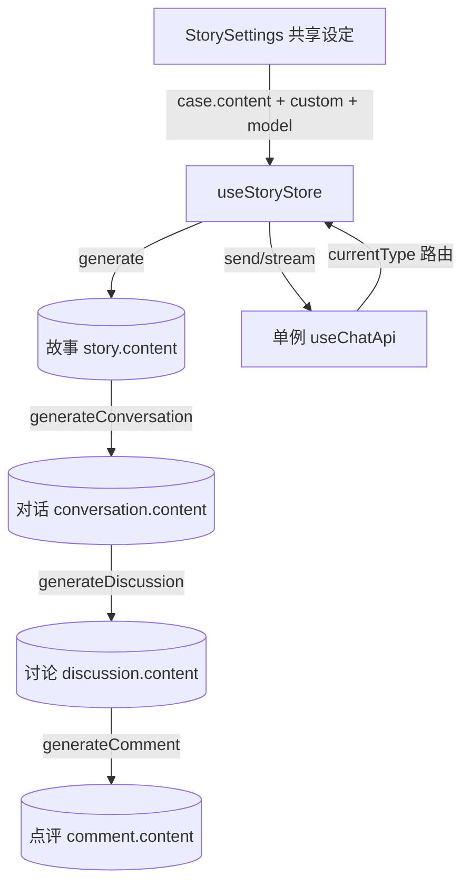

## 用户需求

在“编写故事”页面（`app/pages/cstar/story.vue`）中，除已有的故事生成（`story/generate·fix·verify`）外，新增三类 AI 生成能力，并与故事串联为叙事医学流水线。

## 产品概述

页面以「病例 → 故事 → 对话 → 讨论 → 点评」为递进结构。用户先在右侧共享设定面板配置病例要点与模型，依次生成各阶段内容，逐步沉淀完整的叙事医学素材，每个阶段均可独立编辑、复制、截屏与朗读。

## 核心功能

- 故事生成（已有）：基于病例与要点生成医疗小故事，支持校验与自动修正。
- 对话生成：依据 `conversation/prompt.md`，结合病例与小故事，生成两位角色（默认医生与患者）的专业对话。
- 讨论生成：依据 `discussion/prompt.md`，结合病例、小故事与对话，生成网络评论区风格的精选讨论。
- 点评生成：依据 `comment/prompt.md`，综合病例、故事、对话、讨论，生成五段式专家点评。
- 每张内容卡均支持生成、复制、截屏、朗读、编辑，并适配桌面端与移动端。

## 技术栈

- 框架：Nuxt 4（Vue 3）+ Nuxt UI v4（既有，非 React/shadcn）
- 状态：Pinia（`story` store，单例 `useChatApi` 路由）
- AI 通信：`ai` SDK 流式对话（`@ai-sdk/openai-compatible`），提示词由 `usePromptStore().getEffectivePrompt(type, task)` 加载
- 内容渲染：`Markdown`（`@comark/nuxt`）+ `EditorText` 编辑 + `UChatReasoning` 推理展示
- 持久化：`pinia-plugin-unstorage`（store 状态自动落盘）

## 实现方案

沿用既有「单 store 管理 + 单例 chat 按 `currentType` 路由」模式（见 `story.ts` 与 `useChatApi.ts`），不引入新架构。

1. **扩展 store**：在 `story.ts` 中新增 `conversation / discussion / comment` 三段响应式状态（各含 `content`、`reasoning`），并新增 `generateConversation / generateDiscussion / generateComment` 三个方法。三个生成均复用 `useCaseStore().case.content` 与上游 `story`/`conversation`/`discussion` 的 `content` 拼装上下文，调用 `useChatApi().send`，`currentType` 分别设为 `story-conversation / story-discussion / story-comment`，`instructions` 取自 `getEffectivePrompt('conversation'|'discussion'|'comment','prompt')`，模型沿用 `activeModels.chat`。
2. **流路由**：扩展 `watch(lastParts)` 的 `currentType` 白名单，将三段流式输出写入对应字段（`handleConversationPart` 等），逻辑与既有 `handlePart` 一致（reasoning/text 拆分）。
3. **通用组件**：新建 `app/components/Story/Content.vue`，以 `type` 属性（conversation/discussion/comment）+ `title`/`icon` 驱动，复用 `StoryToolbar` 风格按钮、`EditorText`、`Markdown`、`ButtonClipboard/Capture/Audio/Edit`，并内嵌 `ButtonGenerate type="story" :task="'generate'+Capitalize(type)"`。空状态、Markdown/文本切换、推理展示与 `Story/index.vue` 保持一致。
4. **页面布局**：`story.vue` 主列由「单 Story 卡」改为「四卡纵向堆叠（Story / Conversation / Discussion / Comment）」，右侧保留既有 `StorySettings` 共享面板（自定义/模型/提示词作用于故事；对话等用固定 prompt + 同一 chat 模型）。移动端沿用 `settingsVisible` 折叠逻辑。

## 实现要点（防回归）

- **单例 chat 隔离**：新 `currentType` 必须唯一，避免覆盖 `story.content`；`handlePart` 与新增 handler 互不串写。
- **依赖门控**：对话按钮在 `!story.content` 时禁用，讨论在 `!conversation.content` 时禁用，点评在 `!discussion.content` 时禁用，避免无上下文调用。
- **autoVerify/autoFix 仅作用于 story 系列**：现有 `watch(status)` 条件已限定 `story/story-verify/story-fix`，新类型不会触发自动校验/修正。
- **store 版本**：`story.ts` 顶部 `VERSION` 递增并调用 `syncStoreVersion`，触发旧 localStorage 失效。
- **性能**：单一 chat 实例，无 N+1；流式 reasoning 用 `UChatReasoning` 增量渲染，无额外遍历。

## 架构设计



组件层：`story.vue` → `Story` + `StoryContent×3` + `StorySettings`，均由 `useStoryStore` 驱动。

## 目录结构

```
app/
├── types/
│   └── story.ts                 # [MODIFY] 新增 StorySubContent 接口 { content, reasoning }
├── stores/
│   └── story.ts                 # [MODIFY] 新增 conversation/discussion/comment 状态、三个 generate 方法、watch(lastParts) 路由扩展、reset 清理、VERSION 递增
├── components/
│   └── Story/
│       ├── index.vue            # [保持] 既有故事卡，逻辑不变
│       ├── Content.vue           # [NEW] 通用内容卡（对话/讨论/点评复用），含空态、生成、复制/截屏/朗读/编辑、Markdown/文本切换、推理展示、依赖门控
│       ├── Settings.vue          # [保持] 共享设定面板，无需改动
│       └── Toolbar.vue           # [保持] 既有工具栏，新卡复用其按钮样式
└── pages/
    └── cstar/
        └── story.vue             # [MODIFY] 主列改为四卡纵向堆叠 + 右侧共享设定面板，移动端折叠逻辑不变
```

## 关键代码结构

```ts
// app/types/story.ts
export interface StorySubContent {
  content: string | null
  reasoning: string | null
}

// app/stores/story.ts 新增 API（签名级）
const conversation = ref<StorySubContent>({ content: null, reasoning: null })
const discussion = ref<StorySubContent>({ content: null, reasoning: null })
const comment = ref<StorySubContent>({ content: null, reasoning: null })

async function generateConversation(): Promise<void> // 上下文: case + story.content
async function generateDiscussion(): Promise<void>   // 上下文: case + story + conversation
async function generateComment(): Promise<void>       // 上下文: case + story + conversation + discussion
```

## 设计风格

延续项目既有的 Nuxt UI v4 语义化设计语言（专业、干净、医疗叙事气质），不引入新视觉体系。新增三张内容卡与既有「故事卡」保持完全一致的视觉权重：统一 `UCard` 圆角边框、语义化 `bg-elevated` 头部、`border-default` 分隔、桌面/移动响应式。

## 页面结构（story.vue）

- 顶部：沿用 `UDashboardNavbar`（标题“编写故事”）+ `UDashboardToolbar`（面包屑）。
- 主体（桌面 `md:flex-row`）：左主列 `flex-1 flex-col gap-3` 纵向堆叠四张内容卡（故事 / 对话 / 讨论 / 点评）；右栏 `StorySettings` 固定宽（约 `md:w-96`）。
- 移动端（`flex-col`）：主列全宽堆叠，设定面板通过 `settingsVisible` 折叠，Story 卡头部提供展开按钮。
- 每张内容卡区块：头部 = 图标 + 标题 + 生成/复制/截屏/朗读/编辑操作；主体 = 空态占位（图标 + 文案 + 生成按钮）或 `UChatReasoning` + `Markdown/纯文本` 内容；底部 = 自定义标签 `UBadge`。

## 交互与动效

- 生成中显示 `i-lucide-loader-circle` 旋转图标与禁用态；流式推理默认展开、带柔和过渡。
- 按钮 hover 采用 Nuxt UI 原生 `ghost→soft` 过渡；卡片间 `gap-3` 保持呼吸感。
- 文本/Markdown 双模式切换，纯文本使用 `whitespace-pre-wrap leading-relaxed`。

## 响应式

所有控件 `size="lg/xl"` 触摸友好；操作区在 `md` 以下收起为 `UPopover` 省略号菜单（复用既有 Toolbar 模式）。

## Agent Extensions

### Skill

- **ui-ux-pro-max**
- Purpose: 为新增的对话/讨论/点评三张内容卡提供统一的视觉设计系统（配色、排版、间距、动效），确保与既有 Nuxt UI 语义化风格一致。
- Expected outcome: 产出可落地的设计令牌与组件样式规范，指导 `StoryContent.vue` 与 `story.vue` 的视觉实现，达到专业、干净的医疗叙事观感。