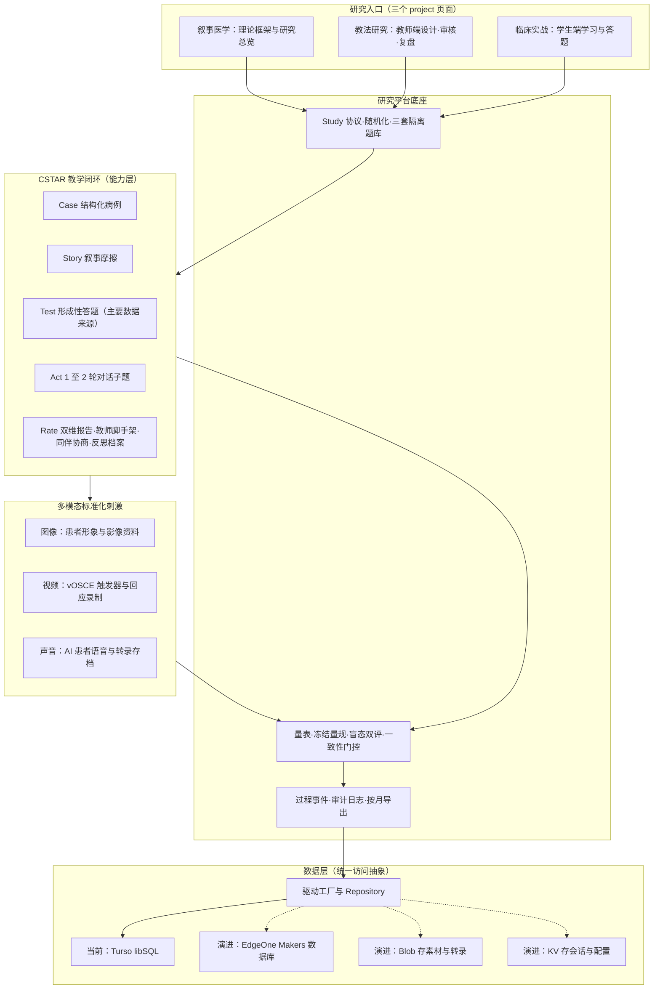
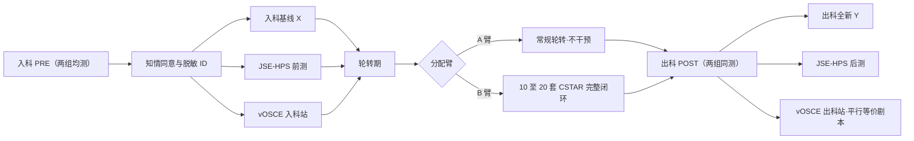
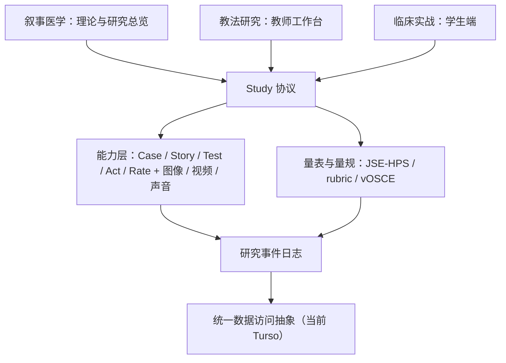
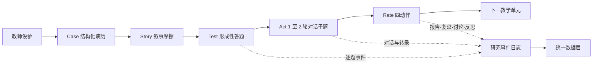

# CSTAR 研究平台整体改造蓝图

> **文档性质**：设计蓝图（本次仅产出文档，未改动任何代码）
> **版本**：v1.0 · 2026-11-11
> **状态**：待评审
> **研究基线**：《研究计划.md》2026-11-02 定稿（单中心平行两臂随机准实验）
> **适用范围**：`urdoc` 平台从「AI 内容生成工具」升级为「可承载多项教改研究的平台」的总体设计依据

---

## 0. 阅读指引

本蓝图采用「一份主蓝图 + 两份专题附录」的单一事实源结构。主文档承载结论、决策与总体设计；附录承载可逐项核对的明细。章节之间以交叉引用代替复制，避免多份文档口径漂移。

| 文档 | 文件 | 用途 | 主要读者 |
| --- | --- | --- | --- |
| 主蓝图（本文） | `app/assets/docs/research/cstar-research-platform-blueprint.md` | 依据与取舍、现状诊断、总体定位、三页面分工、五模块与多模态改造规格、红线与扩展机制 | 课题负责人、评审专家、平台负责人 |
| 附录 A | `app/assets/docs/research/research-data-foundation.md` | 研究域模型、数据表字段方向、时序、API 表面、日志与落库演进 | 后端与数据负责人、方法学顾问 |
| 附录 B | `app/assets/docs/research/gap-matrix-and-roadmap.md` | 逐项差距矩阵、阶段路线图、验收清单、风险映射 | 实施团队、进度管理 |

**引用规则**：正文给出结论与决策，附录 A 给出「数据怎么存、怎么流转」，附录 B 给出「差什么、何时做、如何验收」。三者冲突时以主蓝图结论为准，并应回写修订附录。

---

## 1. 目的、范围与边界

### 1.1 本蓝图要回答的问题

1. 三个 `project` 页面各自承担什么角色——整体叙事医学、教师教学研究、学生学习与答题如何分工而不重复建设？
2. `Case / Story / Test / Act / Rate` 五环节与多模态的图像、视频、声音，分别应做哪些改造才能适配定稿研究计划？
3. 需要怎样的平台化底座，才能让当前课题（省教改课题）与将来更多研究共用同一套能力、同一份数据底座？
4. 现有代码哪些可复用、哪些必须改造、哪些在方法学约束下明确不做？

### 1.2 本次交付边界

- 本次**只新增三份 Markdown 文档**，不改任何 `.vue` / `.ts` / `.json` 业务代码，不改配置、依赖、`docNav` 导航，不执行提交。
- 三份文档置于既有站内文档体系 `app/assets/docs/research/` 下，与 `app/utils/docs.ts` 的 `import.meta.glob('~/assets/docs/**/*.md')` 加载规则天然兼容；是否纳入站内导航属于后续实施事项，注册方式见附录 B。
- 文档描述的是**目标状态与未来实施建议**，不是已实现功能。

### 1.3 表述约定

| 表述 | 含义 |
| --- | --- |
| 「现状」「已有」 | 已通过只读代码核验的当前事实，附相对仓库根的路径与行号 |
| 「建议」「需新增」「需改造」「设计目标」 | 未来实施建议，本次未实现 |
| 「明确不做」 | 受《研究计划.md》§0 核心约束排除，本期不进入确证链 |
| 「待决」 | 需课题负责人、伦理或平台方决策后方可定稿，见第 9 章 |

- 全文统一术语：分配臂 A/B、练习库 / 入科 X / 出科 Y 三库、W1 诊断决策 / W2 心理社会识别 / W3 沟通策略适配、vOSCE、JSE-HPS、盲态双评、反思叙事档案、scaffolding（脚手架）、human-in-the-loop（人工在环审核）。完整术语表见第 10 章。
- 所有路径均相对仓库根 `d:/Projects/GitHub/urdoc/`；Markdown 内的 Mermaid 图仅用于说明设计关系，不代表已部署的数据流。

### 1.4 与课题里程碑的关系

本蓝图服务于《研究计划.md》§13 的三个关键节点：**2027.06（M2）** 手册与量规冻结、**2027.12（M3）** 平台 v2 上线 + 师资培训 + pilot（n≈10）、**2028 年正式采集并按月导出数据 / 2028.08 数据锁定**。阶段划分与可勾选验收项见附录 B。

---

## 2. 依据与唯一基线

### 2.1 五份参考材料及其用法

| 材料 | 定位 | 本蓝图中的用法 |
| --- | --- | --- |
| 《研究计划.md》（整合版 / 2026-11-02 定稿） | 课题单一事实源（single source of truth） | **唯一研究基线**：研究设计、数据字典、指标体系、质量门控、进度与风险 |
| 《CSTAR 答题样例与评分手册（草稿）》v0.1 | 教学与测评素材 | 提供 5 个乳腺病种 A/B 等值病例样例、三维度 rubric 细则、评分通道、格式等价红线；**不沿用其分组与统计设计** |
| 《论文B-临床实战-CSTAR可粘贴文案》 | 后续论文方向（临床前学生） | 作为「未来可配置研究方向」的需求来源：虚拟社区声音、非临床情境任务、社会协商式点评 |
| 《论文C-教法研究-CSTAR可粘贴文案》 | 后续论文方向（教师转型专论） | 作为教师端能力清单来源：三重转型、提示工程、双重质量把关、过程性点评、制度重构 |
| 《CSTAR 相关理论或方法的分析》 | 方法学与评价工具论证 | 作为 vOSCE、OS-12 / Calgary-Cambridge、盲态双评、量表与工具取舍的实施规范来源 |

### 2.2 冲突登记与取舍

材料之间存在版本与场景差异。下表逐项登记，凡与定稿研究计划冲突者一律以后者为准。

| 编号 | 冲突点 | 定稿口径（采用） | 其他材料口径（不采用 / 降级） | 取舍理由 |
| --- | --- | --- | --- | --- |
| C1 | 实验设计 | 平行两臂随机准实验：A 常规轮转不干预，B 常规轮转 + 10 至 20 套 CSTAR 完整闭环 | 评分手册 v0.1 仍为 AB/BA 交叉（B−A、τ、LMM） | 《研究计划.md》§19.9–19.10 已定稿「干预与测评分离」；交叉仅保留为 pilot 与敏感性分析（§7.1） |
| C2 | 题库结构 | 三套互不重叠题库：B 专属练习库、入科基线 X、出科全新 Y | 评分手册的 A/B 等值平行卷用于个体内比较 | 平行设计需隔离练习量混淆与透题污染（§7.3、R3）；等值卷的「格式等价红线」仍保留为出题规范 |
| C3 | 行为层测量 | **vOSCE**：AI 患者对话 + 盲态教师按 OS-12 / Calgary 量规评转录稿 | 论文 B 的 pre-post OSCE、改良 mini-CEX；分析文档中的真实 SP 方案 | §0 核心约束：无真人患者、无真实 SP；mini-CEX 本期不开展，仅列为后续真实场景课题方向（§8.4） |
| C4 | 证据链 | 平台卷面 X/Y（表现）＋ JSE-HPS（态度）＋ vOSCE（行为）＋ 反思叙事档案（质性·探索性） | 患者版 MSF、CBD、SCT 等候选工具 | §8.4 已按「无真人患者」作出最终取舍：MSF / CBD 排除，SCT 仅可选探索 |
| C5 | 研究对象与场景 | 乳腺外科规培生、单中心、线上异步探究 + 线下同步复盘 | 论文 B 的临床前医学生、按班级整群分组、虚拟社区声音、非临床情境任务 | 论文 B 属另一项研究；其能力需求登记为**后续可配置研究方向**，不进入本期确证链 |
| C6 | 教师数据 | 教师为平行于学员流程的独立采集轨（工时结构、scaffolding 行为编码、审核留痕、访谈） | 论文 C 偏重理论论述与行动路径 | 论文 C 的角色/能力/制度重构作为教师端功能需求来源；数据口径以 §7.7、§11 为准 |
| C7 | 结论措辞 | 「CSTAR 程序效应」，不得表述为纯「叙事效应」 | 部分文案隐含「叙事本身被验证」 | 本期未设 C 组（练同等数量常规病例），§7.5 明确该边界 |
| C8 | 主要结局 | 「人文—临床整合推理」总分 0 至 100，W1 40 / W2 30 / W3 30，权重锁库前冻结 | 评分手册中权重标注为「示例」 | §8 单一主要结局规避多重比较；手册示例待 2 名专家审定后冻结 |

> **保留而非废弃**：评分手册的 A/B 病例样例、格式等价红线、rubric criterion 分值、三类评分通道、置信度校准与一致性门控，都是可直接转化为平台题库与量规配置的素材；只是其「分组—统计」框架不采用。

### 2.3 定稿研究事实摘要

后续各章的设计均以以下事实为约束，不再重复论证。

| 主题 | 定稿事实 | 出处 |
| --- | --- | --- |
| 核心约束 | 全部教学与测评在网络平台完成；无真人患者、无真实 SP、无真实学生—患者面对面互动；接受纯虚拟闭环 | §0 |
| 主设计 | 单中心平行两臂随机准实验；A 不干预 / B 完整闭环；入科 X、出科全新 Y，ANCOVA（`Y ~ 臂 + X`）；有效样本 ≥94、计划入组 ≈118 | §7.1–7.6 |
| 五环节修正 | Test 是 Case+Story 之后的**形成性评估 + 主要数据来源**（答题即数据，非前测）；Act 压缩为答题内 1 至 2 轮 AI 患者对话子题；Rate = AI 双维报告 + 教师脚手架 + 在线同伴协商 | §2.3、§18 |
| 一次单元五步 | 教师设参（病种 / 难度 / 叙事冲突）→ Case → Story → Test（逐题记录作答 / 时长 / 置信度 1 至 5）→ Rate（AI 报告 → 教师复盘 → 同伴协商） | §6.1 |
| 主要结局 | 总分 0 至 100，W1 诊断决策 40 / W2 心理社会识别 30 / W3 沟通策略适配 30，权重分析前冻结 | §8 |
| 三源互证 | 表现层 X/Y、态度层 JSE-HPS（20 题 7 点 Likert、10 题反向计分、α ≥0.80）、行为层 pre–post vOSCE（只考 W2+W3，平行等价剧本，盲态评分） | §8、§8.1 |
| 评分通道 | 客观题自动判分；主观题 / 对话子题 = rubric + LLM 辅助评分 + 2 名盲态教师系统内网络双评，分歧第三人仲裁 | §9、§12 |
| 一致性门控 | 人—人 ICC 与 AI—人 Pearson r / ICC / 加权 κ + Bland-Altman 同时报告；ICC ≥0.75 方可进入分析，未达标降级为「AI 辅助、人工主导」 | §9、§10.4 |
| 数据字典 | 脱敏 ID（哈希）、批次、分配臂、题库标签；作答 / 时长 / 置信度 / 阅读时长 / 对话文本 / 报告查看 / 复盘时长；AI 与人工评分；量表与反思档案；教师平行轨；时间戳 / 模型版本 / 提示词版本 | §7.7 |
| 合规治理 | 脱敏、院内本地化部署、RBAC、传输与静态加密、知情同意、自愿参与、答题数据不与个人评价挂钩、结题后保存 5 年、人工在环审核 + RAG 指南、全量日志留痕 | §5.2、§7.8、R1/R4/R10 |
| 教师转型 | 从「病例撰写者 / 讲授者 / 阅卷者」到「学习冲突设计者 + 反思脚手架提供者」；六环节逐环映射、六维度新旧工作流对照、单次复盘 ≤30 分钟 | §11、§11.1–11.3 |
| 系统架构 | 教师端（参数设定 / 内容审核 / 复盘）＋学生端（读病历 / 答题 / 对话 / 报告）；应用层含网络答题引擎、评价与学情分析、数据导出；数据层含答题日志库 / 评分库 / 量表库 / 审计日志 | §5.3 |
| 成果路径 | 论文 A 框架 / B 实证 / C 教师转型 / D 可选 vOSCE 方法学，一课题多文、共用数据底座 | §21 |

### 2.4 本蓝图的派生原则

由上述事实派生出五条不可让渡的设计约束，展开见第 8 章：

1. **无真人患者**：凡需真实患者、真实 SP、真实经管病例的能力，本期不实现。
2. **格式等价**：A/B 题型组合与 rubric 必须一致，唯一系统差异是 B 多 Story 叙事层与线上闭环。
3. **干预与测评分离**：B 臂必须真实经历完整闭环；出科 Y 必须是未在任何训练 / 基线中出现的新题。
4. **测评独立**：vOSCE 患者人格独立于训练引擎，评分留人在环，AI 不单独作为确证证据。
5. **答题即数据**：过程性事件是主要证据来源，数据必须落库、可审计、可按月导出。

---

## 3. 现状诊断

### 3.1 一句话结论

`urdoc` 目前是**单机、单人、浏览器本地的 AI 内容生成工具**：八个内容节点由 AI 生成或简单选择题判分，数据主要驻留 `localStorage`；已具备登录接口直连 Turso，但尚未形成任何研究域能力。

### 3.2 现状能力盘点

| 层次 | 模块 | 现状（已核验） | 证据位置 |
| --- | --- | --- | --- |
| 研究入口 | 叙事医学 | 疾病输入 → AI 生成叙事 → 模板 / 设定 → `NarrativeSheet` + 截屏，是叙事单页生成器 | `app/pages/project/narrative-medicine.vue:20,36-69,88` |
| 研究入口 | 教法研究 / 临床实战 | 各 30 行，仅有 Navbar、无 `#body`；三者 `UDashboardPanel` 的 `id` 均为 `pages-project-narrative-medicine` | `app/pages/project/pedagogical-research.vue:3,6-17`；`clinical-simulation.vue:3,6-17` |
| CSTAR | Case | AI 生成结构化病历 + 校验报告 + 自动更正 + 手工编辑 + 截屏 / 朗读 | `app/components/Case/index.vue:104-154,458-478` |
| CSTAR | Story | 正文 / 医患对话 / 话题讨论 / 专家点评四个 Tab，均为 AI 生成内容的展示与本地编辑 | `app/pages/cstar/story.vue:54-94`；`app/components/Story/Content.vue:116-119,208-215` |
| CSTAR | Test | 仅选择题点选与提交，按标准答案比例算百分比 | `app/components/Test/index.vue:59-112,198-201`；`app/stores/test.ts:117-142` |
| CSTAR | Act | 与 AI 模拟患者自由问诊 → 结束问诊 → AI 生成考题 → 答题 → 得分 | `app/components/Act/index.vue:51-102,138-148,241-359`；`app/components/Act/quiz.vue:42-59`；`app/stores/act.ts:35-47` |
| CSTAR | Rate | 汇总全部记录生成 Markdown「临床能力评估报告」，只展示 / 复制 / 截屏 / 朗读 | `app/components/Rate/index.vue:24,71`；`app/stores/rate.ts:7-13` |
| 多模态 | 图像 | 头像 / 插图 / 自定义 prompt 出图；store 只存远程 URL 以避开 localStorage 配额 | `app/pages/multimodal/image.vue:56-58`；`app/stores/image.ts:22-27` |
| 多模态 | 声音 | 文本转语音（TTS）与朗读；注释掉的是旧 Gitee **TTS** provider，全库无 ASR 代码 | `app/composables/useAudioApi.ts:25-65`；`server/api/audio/index.ts:9-19`；`app/stores/audio.ts:68-348` |
| 多模态 | 视频 | 依病例 / 故事 / 头像生成短片并播放，可调分辨率 / 时长 / 帧数 | `app/pages/multimodal/video.vue:43,106-120,143-171` |
| 编排 | Record | `order`（case→story→test→act→rate→image→video→audio）+ `snapshots` + `needsRegenerate`，用于内容依赖与重新生成提示；UI 可拖拽排序 | `app/stores/record.ts:7,35-38,55-98,110-153,167-179`；`app/utils/recordContent.ts:12,14-71`；`app/components/Record/Flow.vue:17-33,37-69,119-133` |
| 数据 | 持久化 | 14 个 store 使用 `syncStoreVersion` + `pinia-plugin-unstorage/nuxt` 落浏览器 localStorage；`record` 版本 `2026-11-06a` | `nuxt.config.ts:8`；`app/utils/store.ts`；`app/stores/record.ts:7` |
| 数据 | 服务端 | 仅登录接口用 `@libsql/client/http` 直连 Turso 查 `users` 表并 `setUserSession`；`server/db/` 只有迁移文件，`server/utils/` 只有 `resolveApiKey.ts` | `nuxt.config.ts:70-73`；`server/api/auth/login.post.ts:1,15-24,46-51`；`server/db/migrations/001_users.sql:3-9` |

### 3.3 三个关键结构性判断

1. **`record.order` 是内容流程编排，不是实验流程**。它表达「哪个节点内容变化后需要重新生成」，没有受试者、分配臂、测评窗口、题库标签或会话状态；研究流程必须由可配置的 Study / Protocol 驱动（附录 A）。
2. **三个 `project` 页面是入口与视图，不是能力层**。Case / Story / Test / Act / Rate 与多模态应作为被协议调用的能力，避免在三个页面重复实现同一功能（第 5 章）。
3. **数据尚未进入研究数据底座**。绝大多数状态只在浏览器本地；唯一的服务端连接是登录。研究计划 §5.3 要求的答题日志库、评分库、量表库、审计日志均不存在（附录 A）。

### 3.4 已核验的「不存在」清单

| 能力 | 核验结论 | 例外 / 说明 |
| --- | --- | --- |
| 答题计时、置信度 1 至 5 | 无 | `confidence` / 置信度 / 答题时长 / `timeSpent` 全库 0 命中；`timer` 命中均为轮询与防抖 |
| 主观题、对话子题评分 | 无 | 现有判分均为「正确答案比例 × 100」 |
| 人工评分、冻结量规、评分者一致性 | 无 | `rubric` / ICC 无实现；Rate 仅 AI 文本报告 |
| 同伴协商、在线讨论区 | 无 | `Conversation` / `Discussion` / `Comment` 三个组件各 13 行，只是 AI 内容容器，无多人交互 |
| 分组 / 随机化 / 盲态 / 脱敏 ID | 无 | `Case/Settings.vue` 的 `random` 是随机抽教科书条目，非受试随机化 |
| 量表（JSE-HPS 等）、vOSCE、反思叙事档案 | 无 | 提示词与命名中的「量表」均为教科书字段等误匹配 |
| 结构化研究数据导出 | 无 | 唯一导出能力是 `Button/Capture.vue:57-110,316-404` 的页面截屏 PNG / JPG / WebP / SVG / PDF，不是数据导出 |
| 语音输入 / ASR / 转录 / 录像存档、视频触发器、刺激素材库 | 无 | `MediaRecorder` / `getUserMedia` / 转录 / 触发器 0 命中；`trigger` 命中均为 `UTabs` 的 `ui.trigger` |
| 研究域类型与研究 API | 无 | `app/types/` 10 个文件全为内容域；`server/api/` 15 个路由无研究 / 评分 / 量表 / 导出 API |

### 3.5 与既有「文档规划」的关系（防误读）

以下均为**文档中的规划文字**，不是已实现能力，引用时必须标注：

- `app/assets/docs/development/database-plan.md:6` 写「当前完全基于 localStorage」、`:14` 写「当前使用 Turso」，两处表述并存；`:417-437` 规划统一 `execute()` 驱动接口与 `server/db/drivers/edgeone.ts`，`:509`、`:511` 把数据导出与权限细化列为后续扩展。本蓝图复用其驱动抽象与渐进迁移思路，但不把规划当作现状。
- `app/assets/docs/development/data-architecture.md:3,10,18,28` 规划 Record → flat nodes + `parentId` 的树形节点模型与 8 种 `ContentType`；它与现行 `app/utils/recordContent.ts:12` 的 8 步线性 `order` 并不相同。两者是不同层次的设计，不可混称「已实现」。
- `app/assets/docs/project.md:113-135` 的多模态方向、学习分析看板、协作讨论 / 同侪互评属于发展路线愿景，可作为本蓝图的需求印证，但同样不是现状。

### 3.6 差距矩阵

逐项差距（已有 / 需新增 / 需改造 / 明确不做）、代码位置与对应研究计划条款，见**附录 B 第 2 章**；核验证据清单见**附录 B 第 3 章**。

---

## 4. 总体定位

### 4.1 目标定位

把平台从「教师或学生单人使用、一次生成一份内容、数据留在本机」的工具，升级为「由研究协议驱动、按角色分入口、五环节与多模态为可复用能力、全过程数据落库且可审计」的研究平台。当前课题是首个内置协议，后续研究通过配置接入，而不是重新开发一套页面。

### 4.2 三层结构

| 层 | 组成 | 职责 | 关键约束 |
| --- | --- | --- | --- |
| 入口层 | 叙事医学 / 教法研究 / 临床实战三个 `project` 页面 | 按角色呈现研究总览、教师工作台、学生学习与答题 | 只做视图与流程入口，不重复实现能力 |
| 能力层 | Case / Story / Test / Act / Rate 与图像 / 视频 / 声音 | 被协议调用，产出内容、题目、对话、报告与标准化刺激 | 同一能力可被训练闭环与测评窗口以不同参数调用 |
| 底座层 | Study 协议、随机化、三套隔离题库、量表与冻结量规、盲态双评、事件与审计日志、导出 | 决定「谁、在哪个窗口、看到哪套题、由谁评分、留下什么数据」 | 数据落库；学生轨与教师轨并列采集；测评人格与训练引擎解耦 |

### 4.3 目标架构（设计关系，非已部署数据流）

**关系说明**：三页面按角色调用同一协议；Case + Story 为内层、Test 与 Act 为中层、Rate 为外层社会建构闭环；多模态作为标准化刺激同时服务训练与 vOSCE，其中测评人格与训练引擎解耦、评分由盲态教师完成；所有过程数据经事件日志进入统一数据层，学生轨与教师轨并列采集。

### 4.4 设计原则

| 编号 | 原则 | 含义 |
| --- | --- | --- |
| P1 | 协议驱动 | 臂别、窗口、题库、量表、量规、导出口径由 Study / Protocol 配置定义，页面不硬编码研究设计 |
| P2 | 流程与内容解耦 | `record.order` 继续负责内容依赖与重生成提示；实验流程由协议与会话状态负责 |
| P3 | 能力复用 | 五环节与多模态是能力层；训练、基线 X、后测 Y、vOSCE 只是同一能力的不同调用参数 |
| P4 | 测评独立 | vOSCE 患者人格独立于训练引擎，入科 / 出科用平行等价剧本，评分留人在环 |
| P5 | 数据落库 | 研究数据必须进入数据库（当前 Turso），不以浏览器本地存储或截屏作为研究证据 |
| P6 | 合规内置 | 脱敏、RBAC、知情同意、盲态、审核留痕、版本留痕作为底座能力，而非事后补丁 |
| P7 | 面向未来研究 | 新研究、新病种、新量表、新结局通过配置接入，共用同一数据底座（第 9 章） |

### 4.5 两条并列采集轨

| 轨 | 时点 | 主要数据 | 说明 |
| --- | --- | --- | --- |
| 学员轨 | 入科 PRE → 轮转期训练（仅 B 臂）→ 出科 POST | 卷面 X / Y、JSE-HPS、vOSCE、置信度、作答时长、对话文本、反思叙事档案 | 主要结局 ANCOVA 的数据来源 |
| 教师轨 | 与学员入科→出科流程**平行、独立** | 工作时间结构问卷前后测、周工作量日志、复盘时长、scaffolding 行为编码、审核工作量、培训参与、访谈 / 开放问卷、平台操作留痕 | 支撑 Q2 与论文 C；不依赖学员流程是否完成 |

### 4.6 数据落库立场与待决事项索引

- **立场**：研究数据全部落库。当前以 Turso / libSQL 为实现，沿用 `database-plan.md` 的统一 `execute()` 驱动接口与驱动工厂思路；结构化数据入数据库，多模态素材 / 转录 / 录像入 Blob，会话 / 缓存 / 配置入 KV，为 EdgeOne Makers 原生存储预留切换路径（附录 A 第 8 章）。
- **待决**：《研究计划.md》§5.2、§7.8 要求院内本地化部署与敏感数据合规，而 Turso / EdgeOne 属云端形态；两者取舍、正式采集期的部署形态与数据驻留边界，列为待决事项 **D1**（第 9 章、附录 A 第 9 章）。本蓝图不擅自替课题方决定。

---

## 5. 三个研究入口的信息架构

### 5.1 分工原则

三个页面是**按角色划分的入口与视图**，不是三套独立功能：它们通过同一个 Study 协议调用同一组能力（第 6、7 章）。分工依据《研究计划.md》§5.3 的用户层——教师端（参数设定 / 内容审核 / 线下复盘）与学生端（读病历 / 答题 / 对话 / 查看报告），另加一个面向全体角色的理论与研究总览入口。

| 页面 | 角色 | 一句话定位 | 明确不承担 |
| --- | --- | --- | --- |
| `app/pages/project/narrative-medicine.vue` | 全体 / 研究者 | 叙事医学理论框架、研究总览与证据链地图 | 不承担学生答题、不承担教师评分 |
| `app/pages/project/pedagogical-research.vue` | 教师 / 盲态评分者 / 管理员 | 教师工作台：设计、审核、量规、复盘与教师数据采集 | 不承担学生学习流程 |
| `app/pages/project/clinical-simulation.vue` | 学生 | 学生端唯一入口：按窗口完成学习、答题与测评 | 不暴露臂别、题库标签、评分者信息 |

导航现状见 `app/components/App/Sidebar.vue:48-72`（projects 组）、`:73-109`（CSTAR 组）、`:110-134`（多模态组）；三个页面 `UDashboardPanel` 的 `id` 重复问题列入附录 B 的 P-05。响应式与触摸友好按 `AGENTS.md` 要求（移动端纵向堆叠、桌面端横向排列、输入控件 `size="lg"` 或 `size="xl"`）。

### 5.2 叙事医学：整体理论框架与研究总览

现有页面是「疾病输入 → AI 生成叙事单页 → 模板 / 设定 → 截屏」的生成器（`app/pages/project/narrative-medicine.vue:20,36-69,88`），改造时**保留**它作为「叙事素材创作与反思写作」子能力，不推倒重来。

| 建议区块 | 内容 | 数据来源 / 关联 |
| --- | --- | --- |
| 理论框架 | 社会建构主义（Vygotsky 脚手架）＋ 叙事医学（Charon：empathy / reflection / profession / trust）；CSTAR 五模块与内层 / 中层 / 外层三层循环 | 《研究计划.md》§2、`app/assets/docs/project.md:9-55` |
| 研究总览 | 课题基本信息、Q1–Q4、平行两臂设计、三套隔离题库、主要结局与三源互证链、里程碑 | §0、§1.3、§7、§8、§13 |
| 叙事医学能力地图 | 叙事摩擦类型（恐惧记忆、替代疗法、经济顾虑、家属分歧、身体意象、罕见病失控感）与 W2 心理社会识别 / W3 沟通策略适配的对应 | 手册 §5 五个乳腺病种样例 |
| 证据链地图 | 表现层 X/Y → 态度层 JSE-HPS → 行为层 vOSCE → 质性层反思叙事档案；标注「表现—态度—行为」不可相互替代 | §8、§8.4.2、分析 §6 |
| 协议与成果入口 | 当前协议（省教改课题）、后续研究方向（论文 B / C / D）、一课题多文数据底座 | §21、第 9 章 |
| 叙事素材与反思档案 | 跳转 Story / Rate 能力，复用 `NarrativeSheet` 与模板体系 | `app/components/Narrative/`、`app/utils/narrativeTemplates.ts` |

**设计边界**：本页不生成实验数据、不呈现个体作答明细；研究进度与汇总数据只显示脱敏后的聚合视图。

### 5.3 教法研究：教师的教学研究工作台

该页当前为 30 行空壳（`app/pages/project/pedagogical-research.vue:3,6-17`），需从零建设，对应论文 C 与《研究计划.md》§11「教师角色转型」。

| 建议模块 | 关键能力 | 关联条款 |
| --- | --- | --- |
| 冲突设计 | 设定病种、难度、叙事冲突参数；保存为协议版本；AI 生成 Case / Story / 试题初稿 | §6.1 步骤 1、§11.1 准备环节 |
| 内容审核 | human-in-the-loop 审核清单：临床准确性 + 人文真实性双重审核；去标识化、避免偏见；一键纠错与审核留痕 | §5.2、R4、论文 C §4–5 |
| 题库与量规 | 练习库 / 入科 X / 出科 Y 三库维护；A/B 格式等价校验；rubric 与权重由 2 名专家审定后冻结 | §7.3、§8、手册「格式等价红线」 |
| 学情分析 | 读取 AI 双维报告、定位 W1/W2/W3 薄弱维度、查看脱敏聚合过程数据 | §11.1 Test 环节、§12 |
| 复盘脚手架 | 标准化复盘模板（单次 ≤30 分钟）、追问 / 支架 / 元认知提示 / 情感支持 / 纠偏行为编码 | §11.3、§7.7 教师域 |
| 同伴协商组织 | 争议题讨论区按批次隔离，防止透题污染 | §6.1 步骤 5、R3 |
| 教师数据采集 | 工作时间结构问卷前后测、周工作量日志、培训参与、审核工作量、半结构化访谈 / 开放问卷、平台操作留痕 | §7.7、§11 |
| 新旧工作流对照 | 六维度端到端对照（病例来源 / 学生练习 / 教师讲授 / 评价方式 / 共情训练 / 负担结构） | §11.2、论文 C §3–7 |
| 师资培训 | 提示工程、双重质量把关、AI 双维报告解读、基于量规的过程性点评工作坊 | §11.3、论文 C §4–7 |

**两条重要的视图分离**：

1. **教师轨与学员轨并列**：教师数据不依赖「入科 → 出科」流程是否完成，独立采集、独立导出（§7.7、§11）。
2. **盲态评分视图独立**：主观题 / 对话子题 / vOSCE 的评分由非授课教师在系统内网络双评，界面必须隐藏臂别、学员身份、题库标签与 pre/post 时点；评分者视图不得复用教师工作台的学情信息（§9、分析 §8.4）。

### 5.4 临床实战：学生学习与答题闭环

该页当前同为 30 行空壳（`app/pages/project/clinical-simulation.vue:3,6-17`），需建设为学生端唯一入口，按**测评窗口**而非按功能模块组织。

| 环节 | 学生端应呈现 | 数据落点（均为未来实施建议） |
| --- | --- | --- |
| 知情同意 | 自愿参与说明、答题数据不与出科成绩 / 个人评价挂钩的书面告知 | 同意记录、脱敏 ID |
| 入科 PRE | 轻量基线 X、JSE-HPS 前测、vOSCE 入科站 | 卷面事件、量表作答、转录与盲态评分 |
| 轮转期（仅 B 臂） | Case → Story → Test（含逐题置信度 1 至 5）→ Act（1 至 2 轮对话子题）→ Rate（AI 双维报告、教师复盘、同伴协商、反思叙事档案），可重复 10 至 20 套 | 逐题事件、阅读时长、对话文本、报告查看、讨论发言、反思文本 |
| 出科 POST | 全新 Y、JSE-HPS 后测、vOSCE 出科站 | 主要结局、次要结局、行为层评分 |

**盲态与防污染约束**：学生端不显示分配臂、题库标签、标准答案、AI 辅助评分与其他学员作答；B 臂练习库不进入任何测评窗口；讨论区按批次隔离（§7.3、R3、R10）。

### 5.5 入口与能力层的调用关系

---

## 6. CSTAR 五模块改造规格

### 6.0 通用改造项

五个模块在现有实现上是彼此独立的生成页面，改造后须共同满足以下底座要求（均为未来实施建议）：

| 通用项 | 要求 |
| --- | --- |
| 协议参数 | 由 Study 协议注入病种、难度、叙事冲突、题库标签、窗口、臂别可见性，页面不硬编码研究设计 |
| 审核状态 | AI 生成内容区分「草稿 / 待审核 / 已冻结」，教师审核结论与一键纠错全量留痕 |
| 版本留痕 | 记录模型 ID 与版本、温度、提示词模板版本、生成时间戳（§5.2、§7.7 系统域） |
| 事件日志 | 阅读、作答、对话、查看报告、讨论、反思等动作统一写入研究事件日志，区分业务日志与审计日志（附录 A 第 4 章） |
| 能力复用 | 同一能力可被训练闭环、入科 X、出科 Y、vOSCE 以不同参数调用；`record.order` 仅负责内容依赖与重生成提示 |

> **AI 能力现状（已核验）**：服务端 `server/api/chat/providers/aisdk.ts:1-7,32-49` 使用 `streamText`（流式）、`generateText`（非流式）、`convertToModelMessages`、`toUIMessageStream`、`createUIMessageStreamResponse`，provider 由 `createOpenAICompatible` 构造；前端 `app/composables/useChatApi.ts:1-28` 使用 `@ai-sdk/vue` 的 `Chat` 类 + `DefaultChatTransport` + `UIMessage`，统一走 `/api/chat`（`server/api/chat/index.ts:8-24`）。结构化输出可基于 `generateText` 的 `output: Output.object(...)` 配合 Zod（见 `node_modules/ai/docs/03-ai-sdk-core/10-generating-structured-data.mdx:14-45`）；转录能力由 AI SDK Core 的 `transcribe` 提供（同目录 `36-transcription.mdx:8-31`），实际可用性取决于所选 provider 是否提供转录模型。**注意**：`AGENTS.md` 记载的 `server/api/aisdk/text/index.ts` 在当前仓库不存在，实际路径为 `server/api/chat/`，维护时以此为准。

### 6.1 Case（内层 · 结构化病例）

| 维度 | 内容 |
| --- | --- |
| 现状 | AI 生成 + 校验报告 + 自动更正 + 手工编辑（`app/components/Case/index.vue:104-154,458-478`） |
| 改造目标 | 由教师在本环节设定病种 / 难度 / 叙事冲突参数；生成结果进入「待审核」，教师按清单核对临床事实与去标识化，冻结后方可供学生阅读 |
| 数据产出 | 病例版本、审核人 / 结论 / 时间、模型与提示词版本、学生阅读开始与结束时间 |
| 关联条款 | §6.1 步骤 1–2、§5.2 human-in-the-loop、R4 |

### 6.2 Story（内层 · 叙事摩擦）

| 维度 | 内容 |
| --- | --- |
| 现状 | 自由文本 + 医患对话 / 话题讨论 / 专家点评四 Tab，均为 AI 生成内容展示与本地编辑（`app/components/Story/Content.vue:116-119,139,208-215`） |
| 改造目标 | 叙事摩擦结构化：冲突点从可配置清单选取（恐惧记忆、错误信念、替代疗法、经济顾虑、家属分歧、身体意象、罕见病失控感等），并与题目 W2/W3 建立显式映射；A 组「去叙事基础版」与 B 组「叙事情境版」使用同一题型组合与 rubric |
| 数据产出 | 冲突点标签、Story 版本、阅读时长、审核状态 |
| 关联条款 | §6.1 步骤 3、§2.1、手册 §5 与「格式等价红线」 |

### 6.3 Test（中层 · 核心 · 主要数据来源）

这是改造幅度最大的模块。核心修正是：**Test 不是前测，而是 Case+Story 之后循环内的形成性评估与主要数据来源**（§2.3、§10.1、§18）。

| 子项 | 规格 |
| --- | --- |
| 时序 | 协议强制 Case → Story → Test；Test 完成后才进入 Act 对话子题与 Rate |
| 题型 | 单选 / 多选（客观题）、简答 / 短文（主观题）、AI 患者对话子题；A/B 卷题型组合与题量一致 |
| 维度标注 | 每题标注 W1 / W2 / W3 与 rubric criterion；总分 0 至 100 按冻结权重 W1 40 / W2 30 / W3 30 合成 |
| 三库隔离 | 练习库（B 专属）/ 入科 X / 出科 Y 互不重叠；每条作答携带题库标签；Y 必须是未在任何训练 / 基线出现的新题 |
| 逐题事件 | 建议字段：脱敏学员 ID、会话 ID、题目 ID、题库标签、维度、作答文本 / 选项、开始时间、提交时间、用时、置信度 1 至 5、修改次数；批量写入而非逐条实时请求 |
| 评分通道 | 客观题自动判分；主观题 / 对话子题 = 冻结 rubric + LLM 辅助评分 + 2 名盲态教师网络双评，分歧第三人仲裁 |
| 置信度校准 | 过度自信指数 = 平均置信度 − 正确率（同量表换算），作为次要结局 |
| 格式等价校验 | 组卷时自动校验 A/B 题型组合、题量、rubric 一致性；唯一允许的系统差异是 B 多 Story 叙事层与线上闭环 |

> **答题即数据**：逐题事件是主要结局、置信度校准、学习投入与机制分析的共同来源，不得以截屏、本地缓存或事后补录替代（§6.1 步骤 4、§7.7）。

### 6.4 Act（中层 · 对话子题）

| 子项 | 规格 |
| --- | --- |
| 形态压缩 | 由「独立实时问诊引擎」压缩为**答题内 1 至 2 轮 AI 患者对话子题**（§2.3、§10.1、§18）；现有自由问诊作为训练期的可选素材生成能力保留，但不作为主要数据来源 |
| persona | 训练 persona 与 vOSCE 测评 persona **独立配置**（不同提示词、模型参数、平行等价剧本），避免练习效应与光环效应 |
| 复用策略 | 建议复用现有 `Chat` + `DefaultChatTransport` + `/api/chat` 链路；为 vOSCE 建立独立会话与人格配置，不复用训练单例状态 |
| 评分 | 对话子题按手册 §4.4 的 0 至 9 分 rubric（共情确认 / 信息准确 / 决策共享 / 纠偏不贬低 / 针对恐惧记忆）计入 W3；LLM 辅助评分建议用 `generateText` + Zod 结构化输出，但**不得作为确证证据** |
| 存档 | 全程对话与转录文本落库归档，供盲态复评与答辩质证；语音相关见第 7.4 节 |
| 关联条款 | §6.1 步骤 4、§8.1(3)、分析 §8.9 硬要求 1–3 |

### 6.5 Rate（外层 · 社会建构闭环）

现有 Rate 仅生成 / 展示 AI Markdown 报告（`app/components/Rate/index.vue:24,71`），必须拆成四个**可采集动作**：

| 动作 | 规格 | 数据产出 |
| --- | --- | --- |
| ① AI 双维报告 | 按「诊疗 + 共情」输出结构化 W1/W2/W3 维度分与说明，取代纯文本综合评语 | 报告版本、维度分、查看记录 |
| ② 教师脚手架 | 人文研讨 / 追问 / 元认知提示 / 情感支持 / 纠偏；标准化模板，单次 ≤30 分钟 | 复盘时长、scaffolding 行为编码、教师轨事件 |
| ③ 在线同伴协商 | 争议题讨论区，按批次隔离 | 发言文本、时间、参与时长 |
| ④ 反思叙事档案 | 基于平台虚拟病例的反思写作（质性 / 探索性，不作确证结局），盲态教师评文本 | 反思文本、质性编码 |

闭环完成后回到下一教学单元；B 臂需累计 10 至 20 套完整闭环（§7.2）。**Rate 不可纯算法评分**是本课题最重要的模型修正之一（§2.3、§18）。

### 6.6 五模块数据流

### 6.7 模块与研究数据字典的映射

| 数据域（§7.7） | 产生环节 | 关键字段方向 |
| --- | --- | --- |
| 标识 | 入组 / 分配 | 脱敏学员 ID（哈希）、轮转批次、分配臂 A/B、题库标签 |
| 基线 / 后测 | Test（X / Y 窗口） | 总分与各维度分、作答时长、置信度 1 至 5 |
| 训练（B 臂） | Case / Story / Test / Act / Rate | 完成闭环套数、阅读时长、对话子题文本、AI 双维报告查看、教师复盘参与时长 |
| 评分 | Test / Act / Rate / vOSCE | AI 评分、人工双评、仲裁分、双维报告分、人—人 ICC、AI—人一致性 |
| 量表 | 入科 / 出科窗口 | JSE-HPS 前后测、pre–post vOSCE、反思叙事档案 |
| 教师 | 教师平行轨 | 工时问卷、周日志、复盘时长、scaffolding 编码、审核工作量、培训、访谈、平台留痕 |
| 系统 | 全部 AI 调用 | 时间戳、模型版本、提示词版本、温度 |

---

## 7. 多模态改造规格

### 7.1 总体定位

三个多模态页面目前都是「生成并展示」：图像出头像 / 插图、声音做 TTS 朗读、视频生成短片（`app/pages/multimodal/*`）。改造方向是把它们纳入**标准化刺激素材体系**，同时服务两件事：训练期的叙事情境呈现，以及行为层测量 vOSCE 的可复现刺激。约束来自《研究计划.md》§8.1(3) 与分析文档 §8.9——刺激标准化可复现、评分留人在环、全程转录 / 录像存档、如实命名 vOSCE。

| 模态 | 训练期职责 | 测评期（vOSCE）职责 |
| --- | --- | --- |
| 图像 | 患者形象、示意插图、与 Case 绑定的影像资料 | 标准化患者形象 / 情境图（可选），须与训练素材区分 |
| 视频 | 与 Story 一致的叙事短片 | **起步方案**：一次性录制患者视频触发器 + 学员录制回应（分析 §8.9 方案②） |
| 声音 | AI 患者语气 / 语速 / 情绪的 TTS 呈现 | AI 患者语音对话、全程转录（首选方案①的文本 / 语音形态） |

### 7.2 图像

- 复用现有出图链路（`app/pages/multimodal/image.vue:56-58`、`app/stores/image.ts:22-27`），新增「素材实体」：与 Case / Story 绑定、记录生成参数与内容哈希、标注训练或测评用途。
- 教师审核后冻结；冻结版本不得在采集期被重新生成覆盖，避免刺激不一致。
- 大体积图片只把元数据、URL 与哈希写入数据库，实际文件归 Blob（附录 A 第 8 章）；现行 store 只存远程 URL 的做法可作为元数据形态参考，但不能作为研究存档依据。

### 7.3 视频

- **训练短片与测评触发器必须分离**：`app/pages/multimodal/video.vue:43,106-120,143-171` 的生成能力用于训练期叙事素材；vOSCE 触发器是独立、冻结、可复现的标准化刺激。
- 起步方案按分析文档 §8.9 方案②：一次性录制标准化患者片段（演员或 AI 形象），一录多用、全员复用、无持续 SP 成本；学员观看后录制自身告知 / 知情同意回应（视频或音频），由盲态教师评分。
- 入科 / 出科使用**平行等价剧本**并交叉平衡，防止练习效应；评分对象始终是 rubric 行为，不是剧情记忆（分析 §8.5）。
- 须实现录制与归档能力：当前全库无 `getUserMedia` / `MediaRecorder` / 录像存档（附录 B 第 3 章核验 6）。

### 7.4 声音

- **TTS 已有**：`app/composables/useAudioApi.ts:25-65`、`server/api/audio/index.ts:9-19`、`app/components/Button/Audio.vue`；可用于 AI 患者的语气与情绪呈现，但须与 vOSCE 人格配置解耦。
- **转录为新增能力**：AI SDK Core 提供 `transcribe`（`node_modules/ai/docs/03-ai-sdk-core/36-transcription.mdx:8-31`），实际可用性取决于所选 provider 是否提供转录模型；若不可用则需评估外部 ASR 服务，两种路径都须记录模型 / 版本 / 时间戳。当前项目**无任何 ASR 代码**（含注释），注释掉的是旧 Gitee TTS provider。
- 转录文本、分段时间戳、原始音频引用与哈希一并归档，供盲态教师评转录稿；AI 不自动评分。
- **虚拟社区声音**（家属 / 同事 / 社区舆论 / 社区医生多角色 persona）属论文 B 方向，本期「明确不做」，登记为后续可配置能力（第 9 章、附录 B 的 M-08）。

### 7.5 素材生命周期

### 7.6 与研究数据的关系

| 原则 | 说明 |
| --- | --- |
| 大素材不入库 | 数据库只存素材 ID、用途、版本、URL / Blob 引用、内容哈希、审核人、时间戳 |
| 训练与测评不共用刺激 | vOSCE 人格、剧本、触发器与训练引擎解耦，避免练习效应与「格式熟悉」质疑 |
| 可复现 | 固定提示词、模型版本、温度与参数；平行等价版本交叉平衡 |
| 可审计 | 全程转录 / 录像存档、盲态人工评分、如实命名 vOSCE |
| 三类日志分离 | 生成日志（业务）、素材投放与查看（研究事件）、审核与导出（审计），见附录 A 第 4 章 |

---

## 8. 合规与质量红线

> 本章是**实施与验收必须满足的设计约束**，不是当前已实现状态；对应差距项见附录 B 第 2.5 节 Q-01 至 Q-10，验收清单见附录 B 第 5 章。

### 8.1 方法学红线

| 编号 | 红线 | 具体要求 | 违反后果 | 条款 |
| --- | --- | --- | --- | --- |
| R-01 | 无真人患者、纯虚拟闭环 | 不引入真实 SP、患者反馈、真实经管病例采集；论文如实标注替代方式 | 与课题主题错配且伦理不可行 | §0、§8.4 |
| R-02 | 格式等价红线 | A/B 相同题型组合、题量、rubric；唯一系统差异是 B 的 Story 叙事层与线上闭环 | B−A 混入格式效应，比较失效 | 手册「格式等价红线」 |
| R-03 | 干预与测评分离 | B 臂真实经历 10 至 20 套完整闭环；出科 Y 为全新题，不进入任何训练 | 退化为「题面格式熟悉」而非教学法效应 | §7.3、手册 §七补 |
| R-04 | 三库隔离 | 练习库 / 入科 X / 出科 Y 互不重叠；批次错开防透题 | 背题与练习量混淆 | §7.3、R3 |
| R-05 | 测评人格独立 | vOSCE 患者人格、提示词、剧本独立于训练引擎；平行等价版本交叉平衡 | 练习效应、沾光效应、构造效度受损 | §8.1(3)、分析 §8.5 / §8.9 |
| R-06 | 评分留人在环 | 盲态教师完成确证评分；AI 只生成患者与辅助评分；不得把卷面 X/Y 改名成 OSCE | 证据链断裂、审稿质疑 | §9、分析 §8.0 / §8.9 |
| R-07 | 单一主要结局与冻结权重 | W1 40 / W2 30 / W3 30 锁库前冻结；统计计划归档；避免多重比较 | p-hacking、结论不可信 | §8、§9 |
| R-08 | 结论限定 | 本期未设 C 组，B−A 表述为「CSTAR 程序效应」，不得声称单独隔离「叙事」成分 | 过度归因 | §7.5、§19.10 |
| R-09 | 独立量表不取消 | 题目按 mini-CEX 能力项与 JSE 共情域做内容映射，但 JSE-HPS 与 vOSCE 独立保留 | 退化为单方法、丢失态度层 | §8 表注、分析 §11.1 |
| R-10 | 如实命名 vOSCE | 论文与平台明确标注虚拟 OSCE 及所用替代方式（AI 患者对话 / 视频触发器） | 被指隐瞒替代方式 | 分析 §8.9 硬要求 5 |

### 8.2 数据与伦理红线

| 编号 | 红线 | 具体要求 | 条款 |
| --- | --- | --- | --- |
| E-01 | 脱敏与合成数据 | 学员姓名 / 学号不出平台，ID 哈希化；虚拟患者为合成数据 | §7.8 |
| E-02 | 知情同意与自愿 | 非授课教师招募；书面告知数据仅用于教研、不与出科成绩 / 个人评价挂钩 | §7.8、R1 |
| E-03 | 访问控制与加密 | RBAC；传输与静态加密；盲态视图服务端强制过滤 | §7.8、§9 |
| E-04 | 用途限定与留存 | 数据仅用于教研；结题后保存 5 年；锁库后只读、变更留审计 | §7.8、§9 |
| E-05 | 人工在环审核 | AI 生成内容经教师按清单核对临床准确性与人文真实性；医学事实性错误零容忍；RAG 接权威指南 | §5.2、R4 |
| E-06 | 全量日志留痕 | 每次 AI 调用记录模型 / 版本 / 温度 / 提示词版本 / 时间戳；审核与纠错留痕 | §5.2、§7.7 系统域 |
| E-07 | 数据质量 | 无效作答剔除规则；缺失率小于 5% 多重插补，超过则敏感性分析；ITT 与 PP 双分析集 | §9、R10 |
| E-08 | 研究数据落库 | 过程性事件以服务端入库为准，浏览器本地存储与页面截屏不作为研究证据 | 用户决策、主蓝图 P5 |

### 8.3 门控

| 门控项 | 阈值 / 时点 | 未达标处理 | 条款 |
| --- | --- | --- | --- |
| AI—人一致性 | ICC ≥0.75（Pearson r / 加权 κ / Bland-Altman 并报） | 降级为「AI 辅助、人工主导」，不影响主结论 | §9、§10.4 |
| 人—人一致性 | 双评 ICC ≥0.75，分歧第三人仲裁 | 重新校准评估者后再评 | §9、分析 §8.4 |
| JSE 中文版信度 | 预试验 Cronbach's α ≥0.80，注明出处与 10 道反向题 | 更换 / 修订量表版本并复测 | §8.1(1)、§9 |
| 预试验 | pilot n≈10，跑通完整闭环与门控 | 修订方案后再进入正式采集 | §8.1、§13 M3 |
| 量规与权重冻结 | 2 名专家审定、数据分析前锁定 | 不得在锁库后按结果调整 | §8、手册 §8 |
| 样本与统计 | 有效平行样本 ≥94，计划入组 ≈118；ANCOVA 控基线 | 若客流受限，延长采集窗并如实报告功效局限 | §7.6、R2 |

### 8.4 明确不做

「真实 SP 版 mini-CEX、患者版 MSF、CBD、DOPS 整体纳入、SCT 确证化、虚拟社区声音确证测量、AI 自动评分替代人工」等本期排除项，逐条登记在**附录 B 第 2.6 节**，并注明其后续研究方向归属。

---

## 9. 未来研究扩展机制与待决事项

### 9.1 扩展原则：配置而非改代码

《研究计划.md》§21 要求「一课题多文、共用数据底座」。平台应把研究差异收敛到 `study` / `protocol_version` 配置（附录 A 第 2、3 章），能力层保持不变。

| 可扩展维度 | 配置载体 | 示例 | 对数据的影响 |
| --- | --- | --- | --- |
| 臂别 | `arm` | 新增 C 组「练同等数量常规病例」以隔离叙事成分 | 新增 `assignment` 取值，历史数据不变 |
| 窗口 | `window` | 追加随访窗口、迁移测试 | 新增 `session` 记录 |
| 题库与病种 | `item_bank` / `item` | 新增科室、病种、≥6 套标准化教案 | 新增题目与等值标记 |
| 量表 | `scale` | 追加叙事共情量表、自编问卷 | 新增 `scale_response` |
| 量规 | `rubric_version` | OS-12 / Calgary 授权中文版替换自编表 | 新增版本，不改历史评分 |
| 结局 | `protocol_version` | 追加探索性结局（SCT 等） | 分析计划须同步归档，避免多重比较 |
| persona 与素材 | `persona_config` / `media_asset` | 虚拟社区声音、新视频触发器 | 新增素材与角色配置 |
| 导出 | `export_job` | 新研究的数据字典与导出口径 | 新增导出模板，旧包保持只读 |

### 9.2 后续研究方向接入

| 方向 | 需调用 / 新增的能力 | 配置变化 | 约束 |
| --- | --- | --- | --- |
| 论文 B（临床前学生叙事仿真） | 多角色「虚拟社区声音」、非临床情境任务、社会协商式点评 | 新 `study`、按班级整群分组、新题库与量规 | 属另一研究；真实 SP / mini-CEX 部分本期不做（主蓝图 C5） |
| 论文 C（教师转型专论） | 教师工作台、scaffolding 编码、工时与访谈数据 | 教师轨独立协议，不依赖学员流程 | 与 §11、§21 共用教师域数据 |
| 论文 D（可选方法学） | vOSCE 评分、评估者间 ICC、AI—人 Bland-Altman | 新增方法学导出模板 | 须如实标注 vOSCE 替代方式 |
| 后续 C 组 / 真实 SP 场景 | 新臂别、真实场景工具 | 新 `arm` 与新 `rubric_version` | 需重新过伦理与合规审查（§19.9、§8.4） |
| 新病种 / 新科室 / 新量表 | 现有五模块与多模态能力复用 | 新题库、冲突点标签、量表版本 | 内容仍须人工在环审核 |
| 更多教改研究 | 全部能力层 | 注册新 `study` 与 `protocol_version` | 共用底座，不复制页面与表结构 |

### 9.3 新研究接入流程

### 9.4 待决事项

| 编号 | 待决问题 | 影响 | 建议决策时点 | 关联 |
| --- | --- | --- | --- | --- |
| D1 | 正式采集期的部署形态与数据驻留：院内本地化 vs Turso / EdgeOne 云端 | 伦理合规、数据加密与访问、结题材料 | 伦理审批前（2027Q1） | 第 4.6 节、附录 A 第 8.3 / 9 章 |
| D2 | EdgeOne Makers **无托管数据库**条件下的最终存储选型（继续外接 Turso / Blob 为主 / 院内本地化） | 查询能力、迁移成本、导出与一致性策略 | 平台 v2 设计定稿前（2027H1） | 附录 A 第 1.3 / 8.2 / 8.3 章 |
| D3 | 量规权重（示例 40/30/30）与统计计划的冻结责任人、时间、归档形式 | 主要结局可信度、锁库规则 | 2027.06（M2）前 | §8、§9、附录 B 第 6 章 |
| D4 | 多模态转录服务的 provider 选型（AI SDK `transcribe` 可用性 vs 外部 ASR） | vOSCE 转录、盲态评分、模型版本留痕 | 2027H2（平台 v2 上线前） | 第 7.4 节、附录 A 第 3.4 章 |

> 四项均为**待课题方 / 伦理 / 平台方决策**，本蓝图不预设结论；决策结果应回写主蓝图与附录 A、B 对应章节。

### 9.5 与结题成果的关系

《研究计划.md》§14 要求三类结题硬条件：≥1 篇中文知网收录教改论文、1 项被学校采纳的教学改革方案（**2027 年内取得采纳证明**以满足应用满 1 年）、1 套优质数字教学资源。本蓝图对应的平台功能包（三个入口 + 五模块闭环 + 多模态刺激 + 数据底座）、病例题库与操作指南，构成「数字教学资源」主体；教师工作台产出《分步实施手册》与培训材料；数据底座产出可复现的实证数据与分析报告。

---

## 10. 术语表

| 术语 | 含义 |
| --- | --- |
| CSTAR | Case–Story–Test–Act–Rate 五模块教学框架，根植社会建构主义与叙事医学 |
| 三层循环 | 内层 Case+Story（线上异步）、中层 Test 与 Act（线上异步）、外层 Rate（社会建构闭环） |
| 分配臂 A / B | A 常规轮转不干预；B 常规轮转 + 10 至 20 套 CSTAR 完整闭环 |
| 三库 | B 专属练习库、入科基线 X、出科全新 Y，互不重叠 |
| W1 / W2 / W3 | 诊断决策 40 / 心理社会识别 30 / 沟通策略适配 30，构成总分 0 至 100 |
| 格式等价红线 | A/B 题型组合与 rubric 一致，唯一差异为 B 的 Story 叙事层与线上闭环 |
| 答题即数据 | Test 为循环内形成性评估与主要过程性数据来源，非前测 |
| JSE-HPS | 杰斐逊共情量表医学生版，态度层自评，20 题 7 点 Likert、10 题反向计分 |
| vOSCE | 虚拟 OSCE：AI 患者对话（或视频触发器）+ 盲态教师评转录稿，行为层确证性主测量 |
| OS-12 / Calgary-Cambridge | 沟通观察量规，用于 vOSCE 评分框架（须采用授权中文版） |
| 反思叙事档案 | 落在 Rate 的质性 / 探索性写作，基于平台虚拟病例，不作确证结局 |
| scaffolding | 教师复盘中的支架行为：追问 / 支架 / 元认知提示 / 情感支持 / 纠偏 |
| 盲态双评 | 2 名非授课教师隐藏臂别与身份的网络评分，分歧第三人仲裁 |
| ICC / 加权 κ / Bland-Altman | 评分者一致性与人机一致性度量；ICC ≥0.75 为门控 |
| human-in-the-loop | 教师对 AI 生成内容的临床准确性与人文真实性人工审核 |
| ANCOVA | 以入科 X 为协变量、出科 Y 为因变量的协方差分析（主分析） |
| ITT / PP | 意向治疗分析集 / 符合方案分析集 |
| Study / Protocol | 研究注册与冻结协议：臂别、窗口、题库、量表、量规、导出口径的配置载体 |
| 学生轨 / 教师轨 | 学员「入科 → 出科」流程与教师平行独立采集轨 |
| 标准化刺激 | 冻结、可复现、全员一致的患者形象 / 视频触发器 / AI 患者人格 |
| 虚拟社区声音 | 论文 B 方向的多角色 persona（家属 / 同事 / 社区舆论），本期不做 |
| Blob / KV | EdgeOne Makers 的对象存储与边缘键值存储；平台无托管 SQL 数据库，Blob 承担结构化数据 |
| Turso / libSQL | 当前服务端数据库与驱动（`@libsql/client`），SQLite 兼容 |
| Record order | 现有 `app/stores/record.ts` 的 8 步内容编排，只管内容依赖与重生成，不是实验流程 |
| 单一事实源 | 主蓝图承载结论，附录 A / B 承载明细；冲突时以主蓝图为准 |

---

## 文档结构索引

| 章节 | 内容 | 所在文档 |
| --- | --- | --- |
| 第 0–4 章 | 阅读指引、目的边界、依据与冲突取舍、现状诊断、总体定位 | 本文 |
| 第 5–7 章 | 三页面分工、CSTAR 五模块、多模态改造规格 | 本文 |
| 第 8–10 章 | 合规与质量红线、未来研究扩展与待决事项、术语表 | 本文 |
| 附录 A 第 1–3 章 | 技术事实、研究域模型、数据表字段方向 | `research-data-foundation.md` |
| 附录 A 第 4–7 章 | 三类日志、关键时序、API 表面与 Nuxt 4 约定、门控 | 同上 |
| 附录 A 第 8–11 章 | 存储分工与 EdgeOne Makers 演进、合规风险、性能提示、引用 | 同上 |
| 附录 B 第 1–3 章 | 判定口径、逐项差距矩阵、现状核验证据 | `gap-matrix-and-roadmap.md` |
| 附录 B 第 4–8 章 | 阶段路线图、验收清单、冻结与锁库、风险映射、导航注册方式 | 同上 |

**交付边界复核**：本次仅新增上述三份 Markdown 文档，未修改 `app/utils/docs.ts` 的 `docNav`，未改动任何业务代码、配置或依赖，未执行提交；文中所有「建议 / 需 / 应 / 设计目标」均为未来实施建议。
