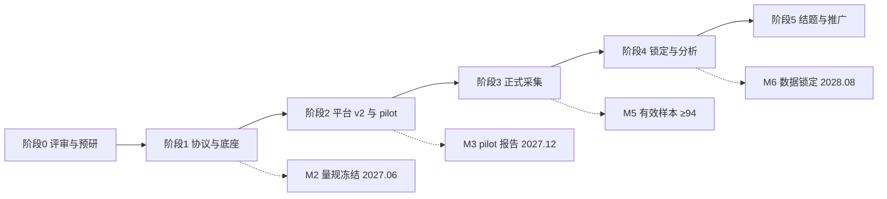

# 附录 B：差距矩阵与分阶段路线图

> **对应主蓝图**：`app/assets/docs/research/cstar-research-platform-blueprint.md`
> **配套附录**：`app/assets/docs/research/research-data-foundation.md`（附录 A）
> **版本**：v1.0 · 2026-11-11 · 状态：待评审
> **性质**：本文件全部内容为现状核验结论与未来实施建议，不代表已实现。

---

## 1. 文档说明

### 1.1 用途

- **第 2 章**：把《研究计划.md》的每条要求映射到现有代码，给出「已有 / 需新增 / 需改造 / 明确不做」判定，供评审逐项追踪、供实施拆任务。
- **第 3 章**：汇总本次只读核验的证据，凡「现状」断言均可回溯到具体路径与行号。
- **第 4 章起**：阶段路线图、验收清单、冻结清单、风险映射、站内文档导航注册方式。

### 1.2 判定口径

| 判定 | 含义 |
| --- | --- |
| 已有 | 当前代码已具备且可复用（可能仅需补充参数或接入协议） |
| 需新增 | 全库无对应实现，需新建能力 |
| 需改造 | 已有实现但语义、口径或数据形态不符研究设计，须调整后复用 |
| 明确不做 | 受《研究计划.md》§0 核心约束或 §8.4 取舍结论排除，本期不实现，仅登记为后续研究方向 |

### 1.3 路径约定

表内路径相对仓库根 `d:/Projects/GitHub/urdoc/`；行号为 2026-11-11 只读核验结果。条款列中的「§」均指《研究计划.md》，「手册」指《CSTAR 答题样例与评分手册（草稿）》v0.1，「分析」指《CSTAR 相关理论或方法的分析》。

---

## 2. 差距矩阵

### 2.1 三个研究入口

| 编号 | 能力项 | 判定 | 现状与代码位置 | 未来实施建议（目标） | 条款 |
| --- | --- | --- | --- | --- | --- |
| P-01 | 叙事医学页作为整体理论与研究中枢 | 需改造 | 现为叙事单页生成器：疾病输入、生成叙事、模板 / 设定、截屏；`app/pages/project/narrative-medicine.vue:20,36-69,88` | 保留生成器为「叙事素材创作」子能力，新增理论框架、研究总览、协议与证据链入口 | §1.3、§2、§21 |
| P-02 | 叙事单页生成与模板体系 | 已有 | `app/components/Narrative/Sheet.vue`、`TemplatePicker.vue`、`SettingsPopover.vue`；`app/utils/narrativeTemplates.ts` | 作为 Story 叙事素材与反思叙事档案的呈现载体接入协议 | §8.4.1 反思叙事档案 |
| P-03 | 教法研究页（教师工作台） | 需新增 | 30 行空壳，只有 Navbar；`app/pages/project/pedagogical-research.vue:3,6-17,21-29` | 建设冲突设计、内容审核、量规冻结、复盘脚手架、教师数据采集与师资培训入口 | §11、§11.1–11.3、论文 C |
| P-04 | 临床实战页（学生端） | 需新增 | 30 行空壳，只有 Navbar；`app/pages/project/clinical-simulation.vue:3,6-17,21-29` | 建设入科 / 轮转 / 出科窗口导航、学习与答题闭环、报告与讨论入口 | §6.1、§7.2–7.3 |
| P-05 | 三页面唯一标识与导航语义 | 需改造 | 三页 `UDashboardPanel` 的 `id` 均为 `pages-project-narrative-medicine`（`:2` / `:3` / `:3`）；导航注册在 `app/components/App/Sidebar.vue:48-72` | 修正 id 与面包屑 / i18n 键，按角色重组三个入口 | AGENTS.md 响应式与 i18n 规范 |
| P-06 | 三页面共享能力而非各自实现 | 需新增 | 五个 CSTAR 页面与多模态页面各自独立（`app/pages/cstar/*`、`app/pages/multimodal/*`），无协议调用层 | 三页面只做视图与流程调度，通过协议调用同一能力层 | 主蓝图 P3 |

### 2.2 CSTAR 五模块

| 编号 | 能力项 | 判定 | 现状与代码位置 | 未来实施建议（目标） | 条款 |
| --- | --- | --- | --- | --- | --- |
| C-01 | Case 动态结构化病历生成 | 已有 | `app/components/Case/index.vue:104,107`；`app/stores/case.ts` | 接入教师参数（病种 / 难度 / 叙事冲突），增加教师审核状态与版本留痕 | §6.1 步骤 1–2、§5.2 |
| C-02 | Case 事实性校验与一键纠错留痕 | 需改造 | 校验报告与自动更正已存在：`app/components/Case/index.vue:111-154,458-478`；提示词 `app/assets/prompts/case/verify.md` | 从「AI 自校验」升级为 human-in-the-loop 审核清单与审核留痕（审核人 / 结论 / 时间 / 版本） | §5.2、R4 |
| C-03 | Story 叙事摩擦的结构化参数 | 需改造 | Story 为自由文本 + 四个 Tab；`app/components/Story/Content.vue:116-119,139,208-215` | 冲突点可配置（家庭癌症史 / 恐癌 / 替代疗法 / 经济顾虑 / 家属分歧），并与题目 W2/W3 建立映射 | §6.1、手册 §5 |
| C-04 | Story 的医患对话 / 讨论 / 点评 | 需改造 | 三个组件各 13 行，仅为 AI 内容容器：`app/components/Conversation/index.vue:2-7`、`Discussion/index.vue:2-7`、`Comment/index.vue:2-7`；无多人交互 | 区分「AI 生成的示范材料」与「真人同伴协商区」，后者落库留痕 | §2.1 Rate、§6.1 步骤 5 |
| C-05 | Test 定位为循环内形成性评估 | 需改造 | 现为独立出题 + 选择题提交；`app/components/Test/index.vue:59-112`；`app/stores/test.ts:124-142` | 置于 Case+Story 之后由协议调度，成为「答题即数据」的主入口，而非前测 | §2.3、§10.1、§18 |
| C-06 | 三维度题目与冻结权重 | 需新增 | 无 W1/W2/W3 字段与权重；`app/types/test.ts` 仅内容域 | 题库按 W1 40 / W2 30 / W3 30 标注维度，权重由协议版本冻结，锁库后不可改 | §8、手册 §2 |
| C-07 | 题型：选择 + 简答 + 对话子题 | 需新增 | 只有选择题；`app/components/Test/index.vue:59-94` | 支持三类题型同卷组合，满足 A/B 格式等价红线（同题型组合、同 rubric） | 手册「格式等价红线」 |
| C-08 | 三套隔离题库与标签 | 需新增 | 无题库概念；`app/types/` 10 个文件均为内容域 | 练习库（B 专属）/ 入科 X / 出科全新 Y 物理或逻辑隔离，标签随每条作答落库，防背题与透题 | §7.3、R3 |
| C-09 | 逐题作答 / 时长 / 置信度 1 至 5 采集 | 需新增 | 全库 `confidence` / 答题时长 / `timeSpent` 0 命中；`app/stores/test.ts:117-142` 只存答案与总分 | 逐题事件落库（答案、开始 / 提交时间、用时、置信度），支撑主要结局与置信度校准 | §6.1 步骤 4、§7.7、§8 次要 4 |
| C-10 | 客观题自动判分 | 已有 | `app/stores/test.ts:124-142`；`app/stores/act.ts:35-47` | 保留并接入维度分与题库标签 | §12 |
| C-11 | 主观题 / 对话子题 rubric + LLM 辅助评分 | 需新增 | 无 rubric、无 LLM 评分通道；`app/assets/prompts/rate/prompt.md` 仅生成文本报告 | 建立冻结量规、LLM 辅助评分与版本留痕；评分结果不得作为确证证据单独使用 | §9、§12、手册 §3–4 |
| C-12 | 双盲教师网络评分与第三人仲裁 | 需新增 | 无评分者、盲态、一致性实现 | 系统隐藏臂别 / 身份 / 题库标签，双评分歧触发仲裁，计算人—人 ICC 与 AI—人一致性 | §9、分析 §8.4 |
| C-13 | Act 从自由问诊压缩为 1 至 2 轮对话子题 | 需改造 | 现为自由问诊 → 结束 → AI 出题 → 答题；`app/components/Act/index.vue:51-102,138-148,241-359` | 保留 AI 患者引擎，新增「答题内短对话子题」模式，限制轮次、固定 persona 与评分 rubric | §2.3、§10.1、§18 |
| C-14 | AI 患者 persona 与训练 / 测评解耦 | 需新增 | 训练对话由 `app/components/Act/index.vue:138-148` 的 `type:'act'` 驱动，无独立测评人格 | vOSCE 使用独立于训练引擎的人格与平行等价剧本，交叉平衡防练习效应 | §8.1(3)、分析 §8.5 / §8.9 |
| C-15 | 对话文本与转录存档 | 需新增 | 对话仅存于 `app/stores/act.ts:3-15` 的本地状态 | 全量对话与转录落库并归档，供盲态复评与答辩质证 | §7.8、分析 §8.9 硬要求 3 |
| C-16 | Rate 从纯 AI 报告到社会建构闭环 | 需改造 | 仅生成 / 展示 Markdown 报告；`app/components/Rate/index.vue:24,71`；`app/stores/rate.ts:7-13` | 拆为「AI 诊疗+共情双维报告」「教师脚手架复盘」「在线同伴协商」「反思叙事档案」四个可采集动作 | §2.1、§2.3、§6.1 步骤 5 |
| C-17 | AI 双维报告（诊疗 + 共情） | 需改造 | `app/assets/prompts/rate/prompt.md:8-33` 为临床能力综合评估文本，无双维分 | 按 W1/W2/W3 输出结构化双维报告，记录查看行为作为过程数据 | §6.1 步骤 5、§7.7 |
| C-18 | 教师复盘与 scaffolding 行为编码 | 需新增 | 无复盘记录、无行为编码 | 标准化复盘模板（单次 ≤30 分钟），编码追问 / 支架 / 元认知提示 / 情感支持 / 纠偏，进入教师平行轨 | §11、§11.3 |
| C-19 | 在线同伴协商讨论区 | 需新增 | `app/components/Discussion/index.vue:2-7` 为 AI 生成内容容器，无多人交互 | 争议题讨论区，按批次隔离防透题，发言与时长落库 | §2.1、§6.1 步骤 5 |
| C-20 | 反思叙事档案（质性 / 探索性） | 需新增 | 无写作档案；`app/components/Narrative/Sheet.vue` 可作展示载体 | 基于平台虚拟病例的反思写作，落在 Rate，盲态教师评文本，不作确证结局 | §8.4.1、§8.4.2 |

### 2.3 多模态：图像 / 视频 / 声音

| 编号 | 能力项 | 判定 | 现状与代码位置 | 未来实施建议（目标） | 条款 |
| --- | --- | --- | --- | --- | --- |
| M-01 | 图像生成（患者形象 / 插图 / 影像资料） | 需改造 | 头像 / 插图 / 自定义 prompt 出图；`app/pages/multimodal/image.vue:56-58`；`app/stores/image.ts:22-27` 只存远程 URL | 从「创作」升级为「标准化刺激素材」：与 Case 绑定、可复现、带审核状态与版本哈希 | §5.2 可复现、分析 §8.9 硬要求 1 |
| M-02 | 素材元数据与 Blob 归档 | 需新增 | 仅存远程 URL，无素材库 / 哈希 / 版本；`app/stores/image.ts:42-50` | 大体积素材入 Blob，库内只存元数据、URL 与哈希，避免数据库膨胀 | 主蓝图 P5、附录 A 第 8 章 |
| M-03 | vOSCE 视频触发器（起步方案） | 需新增 | 全库无「触发器 / 刺激素材」概念；`app/pages/multimodal/video.vue:43,106-120` 仅生成短片 | 一次性录制标准化患者片段（AI 形象或演员），入科 / 出科用平行等价版本，全员复用 | §8.1(3) 起步方案、分析 §8.9 方案② |
| M-04 | 学员回应录制与存档 | 需新增 | `getUserMedia` / `MediaRecorder` / 录像 0 命中 | 学员看触发器后录制自身回应（视频或音频），归档供盲态评分 | 分析 §8.9 方案②、硬要求 3 |
| M-05 | 视频生成用于叙事情境 | 已有 | 依病例 / 故事 / 头像生成短片；`app/pages/multimodal/video.vue:143-171` | 作为训练期叙事素材，与测评触发器明确区分（测评刺激不得复用训练素材） | 主蓝图 P4 |
| M-06 | AI 患者语音（TTS） | 已有 | `app/composables/useAudioApi.ts:25-65`；`server/api/audio/index.ts:9-19`；`app/components/Button/Audio.vue` | 用于患者语气 / 情绪的标准化呈现，与 vOSCE 人格解耦 | §8.1(3) 首选方案 |
| M-07 | 语音输入 / ASR / 转录 | 需新增 | 全库无 ASR 代码（含注释）；注释掉的是旧 Gitee **TTS** provider：`app/stores/audio.ts:68-348` | 支持 vOSCE 语音对话与全程转录，转录文本入库存档 | §8.1(3)、分析 §8.9 硬要求 3 |
| M-08 | 多角色「虚拟社区声音」 | 明确不做（本期） | 无角色群；`app/assets/prompts/conversation/prompt.md` 仅单一角色设定 | 登记为论文 B 方向的可配置能力：家属 / 同事 / 社区舆论 / 社区医生多角色 persona | 主蓝图 C5、第 9 章 |
| M-09 | 素材审核与版本留痕 | 需新增 | 无审核状态；`app/stores/image.ts:165,187,224` 仅写入生成结果 | 所有刺激素材经教师审核后冻结，记录模型 / 提示词 / 参数 / 时间戳 | §5.2 全量日志留痕、R4 |

### 2.4 研究底座与数据层

| 编号 | 能力项 | 判定 | 现状与代码位置 | 未来实施建议（目标） | 条款 |
| --- | --- | --- | --- | --- | --- |
| D-01 | Study / Protocol 配置驱动 | 需新增 | 全库无研究域类型；`app/types/` 10 个文件均为内容域 | 协议定义臂别、窗口、题库、量表、量规、导出口径，页面不硬编码研究设计 | 主蓝图 P1、附录 A 第 2 章 |
| D-02 | 随机化与分配臂 A/B | 需新增 | `app/components/Case/Settings.vue:58-63` 的 `random` 是随机抽教科书条目，非受试随机化 | 按轮转批次或个体随机分配，记录分配序列与时间戳 | §7.2、§7.6 |
| D-03 | 脱敏学员 ID（哈希）与知情同意 | 需新增 | 无受试者标识；`server/db/migrations/001_users.sql:3-9` 只有 id / name / password_hash | 姓名学号不出平台，ID 哈希化；知情同意记录与用途限定 | §7.7、§7.8、R1 |
| D-04 | 角色与权限（学生 / 教师 / 盲态评分者 / 管理员） | 需新增 | 仅登录会话 `server/api/auth/login.post.ts:46-51`；`app/stores/user.ts` 为空壳 | RBAC + 盲态视图（隐藏臂别 / 身份 / 题库标签），非授课教师评分 | §7.8、§9 |
| D-05 | 研究事件日志（答题即数据） | 需新增 | 无事件模型；`app/stores/record.ts:35-38` 的 `order` / `snapshots` 是内容签名，不是实验事件 | 逐题事件批量写入，区分业务日志 / 研究事件日志 / 审计日志 | §6.1、§7.7、附录 A 第 4 章 |
| D-06 | 量表管理（JSE-HPS 前后测） | 需新增 | 无量表实现；`app/assets/books/neurology.ts:150` 的「精神行为量表」为教科书字段误匹配 | 中文版 20 题 7 点 Likert、10 题反向计分，预试验检验 α ≥0.80 | §8.1(1)、§9 |
| D-07 | 冻结量规与版本管理 | 需新增 | 无 rubric；评分手册权重与 criterion 仍为示例 | 2 名专家审定后冻结，写入统计计划归档，锁库前定稿 | §8、§9、手册 §8 |
| D-08 | 盲态双评与一致性统计 | 需新增 | 无评分者 / ICC / κ / Bland-Altman 实现 | 双评 + 第三人仲裁；同时报人—人 ICC 与 AI—人一致性，ICC ≥0.75 门控 | §9、分析 §8.4 |
| D-09 | vOSCE 考站与平行剧本 | 需新增 | 无考站、无剧本、无转录评分 | 10 至 12 分钟沟通站，只考 W2+W3，OS-12 / Calgary 量规，平行等价剧本交叉平衡 | §8.1(3)、分析 §8.2–8.6 |
| D-10 | 教师平行采集轨 | 需新增 | 无教师域数据；`app/pages/project/pedagogical-research.vue` 为空壳 | 工时问卷、周日志、复盘时长、scaffolding 编码、审核工作量、访谈、平台留痕 | §7.7、§11 |
| D-11 | 按月数据导出与数据锁定 | 需新增 | 唯一导出是页面截屏：`app/components/Button/Capture.vue:57-110,316-404` | 结构化导出（脱敏、带数据字典与版本号），按月执行，锁库后只读 | §13 阶段三、§14、§9 |
| D-12 | 模型 / 提示词版本 / 温度 / 时间戳留痕 | 需新增 | 生成链路有 `app/utils/prompts.ts` 加载模板，但无版本留痕 | 每次 AI 调用记录模型、版本、温度、提示词版本与时间戳，支撑可复现 | §5.2、§7.7 系统域 |
| D-13 | 服务端数据落库（当前 Turso） | 需改造 | `nuxt.config.ts:70-73` 有配置；`server/api/auth/login.post.ts:1,15-24` 直连；`server/db/index.ts` 与 `server/utils/db.ts` 不存在 | 建驱动工厂 / Repository / 迁移，研究数据统一经由服务端入库，不再依赖 localStorage 作为证据 | 用户决策、附录 A 第 6–8 章 |
| D-14 | EdgeOne Makers 数据库 / Blob / KV 演进 | 需新增 | 仅 `app/assets/docs/development/database-plan.md:417-437,506-511` 的规划文字 | 结构化数据入 DB、素材与转录入 Blob、会话与配置入 KV，驱动可切换 | 用户决策、`database-plan.md` §7 |
| D-15 | 现有 8 步内容编排 | 已有 | `app/stores/record.ts:7,35-38,55-98`；`app/utils/recordContent.ts:12,14-71`；`app/components/Record/Flow.vue:37-69` | 保留为内容依赖 / 重生成提示，与实验流程解耦，不做实验流程使用 | 主蓝图 P2 |

### 2.5 合规与质量

| 编号 | 能力项 | 判定 | 现状与代码位置 | 未来实施建议（目标） | 条款 |
| --- | --- | --- | --- | --- | --- |
| Q-01 | 无真人患者 / 纯虚拟闭环 | 明确不做（反向约束） | 平台全部为 AI 生成内容，无真人患者接触能力 | 不引入真实 SP / 患者反馈 / 真实经管病例采集，论文如实标注纯虚拟闭环 | §0、§8.4.2 |
| Q-02 | 格式等价红线 | 需新增 | 无 A/B 卷校验 | 出题与组卷时校验题型组合、题量、rubric 一致性，唯一差异为 Story 层 | 手册「格式等价红线」 |
| Q-03 | 干预与测评分离 | 需新增 | 无窗口 / 题库隔离 | B 臂完整闭环与出科 Y 新题分离，练习库不进入任何测评 | §7.3、手册 §七补 |
| Q-04 | 测评人格独立于训练引擎 | 需新增 | `app/components/Act/index.vue:138-148` 训练与对话共用一套调用 | vOSCE 人格、提示词与模型配置独立，入科 / 出科平行人格 | 分析 §8.9 硬要求 1 |
| Q-05 | 评分留人在环 | 需新增 | 无人工评分 | AI 只生成患者与辅助评分，确证评分由盲态教师完成 | §9、分析 §8.9 硬要求 2 |
| Q-06 | ICC ≥0.75 / α ≥0.80 门控 | 需新增 | 无统计实现 | 预试验验证；未达标降级为「AI 辅助、人工主导」，不影响主结论 | §9、§10.4 |
| Q-07 | 知情同意、自愿参与、用途限定 | 需新增 | 无同意记录 | 非授课教师招募；答题数据不与出科成绩 / 个人评价挂钩并书面告知 | §7.8、R1 |
| Q-08 | 脱敏、加密、RBAC、保存 5 年 | 需新增 | 仅登录会话，无合规控制 | 传输与静态加密、角色权限、结题后保存 5 年、可审计 | §7.8 |
| Q-09 | 无效作答剔除、缺失处理、ITT / PP | 需新增 | 无数据质量规则 | 限时窗口、全同作答 / 时长过短剔除；缺失率小于 5% 多重插补，超过则敏感性分析；双分析集 | §9、R10 |
| Q-10 | 单一主要结局与统计计划归档 | 需新增 | 无结局定义 | 权重与统计计划锁库前冻结，避免多重比较与 p-hacking | §8、§9 |

### 2.6 「明确不做」汇总（本期）

| 编号 | 不做项 | 依据 | 后续研究方向 |
| --- | --- | --- | --- |
| N-01 | 真实 SP 版 mini-CEX、真实患者接触 | §0、§8.4.1 | 未来真实临床场景课题 |
| N-02 | 患者版 MSF、CBD（真实经管病例） | §8.4.1 无真人患者约束 | 未来真实场景；其精神由反思叙事档案保留 |
| N-03 | DOPS 整体纳入、SCT 确证化、EPA / ITER / OSATS | §8.2、§8.4.1、分析 §9 | 仅可作探索性子项 |
| N-04 | 虚拟社区声音、非临床情境任务的确证性测量 | 主蓝图 C5（论文 B 属另一研究） | 作为后续协议的可配置能力 |
| N-05 | 把卷面 X/Y 直接改名为 OSCE | 分析 §8.0「测量仪器新增，不重贴标签」 | vOSCE 与卷面两轨并行 |
| N-06 | 用 AI 自动评分替代人工确证评分 | §9、分析 §8.9 硬要求 2 | AI 仅辅助；高利害评价必须人工兜底 |

---

## 3. 现状断言核验表

本章为第 2 章「现状」列的证据汇总。本次核验为**只读**，未修改任何文件。

| # | 断言 | 证据（路径:行号） | 结论 |
| --- | --- | --- | --- |
| 1 | 叙事医学页已实现叙事单页生成；另两页为空壳且三页 id 重复 | `app/pages/project/narrative-medicine.vue:2,20,36-69,88`；`pedagogical-research.vue:3,6-17`；`clinical-simulation.vue:3,6-17` | 成立；两空壳页各 30 行（末行为空 `style` 标签），非 29 行 |
| 2 | Test 仅选择题判分；无计时、无置信度 | `app/components/Test/index.vue:59-112,198-201`；`app/stores/test.ts:117-142`；全库 `confidence` / 答题时长 / `timeSpent` 0 命中 | 成立 |
| 3 | Act 为自由问诊 + 出题 + 得分 | `app/components/Act/index.vue:51-102,138-148,241-359`；`Act/quiz.vue:42-59`；`app/stores/act.ts:35-47` | 成立；得分公式同为「正确比例 × 100」 |
| 4 | Rate 仅 AI Markdown 报告 | `app/components/Rate/index.vue:24,71`；`app/stores/rate.ts:7-13,60,85-109` | 成立；无人工评分 / 量规 / 一致性实现 |
| 5 | 对话 / 讨论 / 点评组件无多人交互 | `app/components/Conversation/index.vue:2-7`；`Discussion/index.vue:2-7`；`Comment/index.vue:2-7`；`Story/Content.vue:208-215` | 成立；仅单人本地编辑 |
| 6 | 多模态为图像 URL / TTS / 短片；无 ASR、无触发器、无素材库 | `app/stores/image.ts:22-27,42-50`；`app/composables/useAudioApi.ts:25-65`；`server/api/audio/index.ts:9-19`；`app/pages/multimodal/video.vue:43,106-120`；`trigger` 命中均为 `UTabs` 的 `ui.trigger` | 成立；**需修正**：不存在「旧 ASR 注释」，整段注释的是旧 Gitee TTS provider（`app/stores/audio.ts:68-348`） |
| 7 | Record 只做 8 步内容编排 | `app/stores/record.ts:7,35-38,55-98,110-153,167-179`；`app/utils/recordContent.ts:12,14-71`；`app/components/Record/Flow.vue:17-33,37-69,119-133` | 成立；无受试者 / 臂别 / 窗口 / 会话字段 |
| 8 | `app/types/` 无研究域类型；`server/api/` 无研究 API；`server/db/` 与 `server/utils/` 文件清单 | `app/types/` 10 个文件；`server/api/` 15 个 `define...` 路由；`server/db/migrations/001_users.sql`；`server/utils/resolveApiKey.ts` | 成立；`server/db/index.ts`、`server/utils/db.ts` 不存在 |
| 9 | Turso 依赖与登录直连 | `nuxt.config.ts:70-73`；`package.json:18,25,27,32`；`server/api/auth/login.post.ts:1,15-24,46-51`；`server/db/migrations/001_users.sql:3-9` | 成立；附注：迁移文件 `:5` 行尾多一个逗号，存在 SQL 语法瑕疵，后续实施需修正 |
| 10 | 站内文档体系与既有规划文字 | `app/utils/docs.ts:19-59,84-99,105-128`；`app/pages/docs/[...slug].vue:29,43-45,55-59`；`app/assets/docs/development/database-plan.md:6,14-15,417-437,506-511`；`data-architecture.md:3,10,18,28`；`app/assets/docs/project.md:113,127-135` | 成立；**须标注为文档规划**，与现行实现（localStorage + 登录直连 Turso + 8 步线性 order）不同 |
| 11 | 侧边栏导航与 i18n | `app/components/App/Sidebar.vue:48-72,73-109,110-134,135-140`；`i18n/locales/zh.json`、`en.json`；`nuxt.config.ts:18-21` | 成立；i18n 目录在项目根而非 `app/` 下 |
| 12 | 研究域实现代码为 0，例外清单 | 文档规划：`database-plan.md`、`data-architecture.md`、`project.md`；UI 文案：`i18n/locales/zh.json:13,24`；截屏导出：`app/components/Button/Capture.vue:57-110,316-404`；其余为教科书字段 / 随机种子 / 模板命名等误匹配 | 成立；0 处研究域实现代码 |

---

## 4. 分阶段路线图

阶段划分对齐《研究计划.md》§13 与里程碑 M2 / M3 / M5 / M6，并计入本次新增的待决事项（主蓝图第 9 章 D1–D4）。所有交付物均为**未来实施建议**。

| 阶段 | 时间 | 目标 | 主要交付 | 对应差距项 | 验收要点 | 依赖与风险 |
| --- | --- | --- | --- | --- | --- | --- |
| 阶段 0 · 评审与预研 | 2026Q4–2027Q1 | 蓝图定稿、待决项决策、伦理与合规准备 | 蓝图和附录评审、D1 数据驻留与 D2 存储选型结论、伦理申请与知情同意文本、驱动抽象技术验证 | 全部（评审） | 待决项有书面结论；合规边界获伦理方确认 | D1 / D2 未决将阻塞阶段 1；R1、R8 |
| 阶段 1 · 协议与底座定稿 | 2027.01–2027.06（M2） | 研究可配置化与题库 / 量规冻结 | Study / Protocol 与域模型落库（附录 A 第 2–3 章）、三套隔离题库、A/B 等值校验、冻结 rubric 与权重、教师工作台与学生端窗口骨架、Turso 驱动与 Repository（附录 A 第 6、8.1 章） | D-01 至 D-08、D-13、C-06 至 C-08、P-03 至 P-06、Q-02 至 Q-03 | 2 名专家审核通过；量规与权重冻结；统计计划归档口径确定 | D3；R4、R7；`001_users.sql:5` 语法瑕疵须先修正 |
| 阶段 2 · 平台 v2 与预试验 | 2027.07–2027.12（M3） | 完整闭环跑通 + pilot 门控 | Test / Act / Rate 闭环（主蓝图第 6 章）、JSE-HPS 前后测、vOSCE 首选或起步方案（第 7 章）、盲态双评、教师平行轨、按月导出、师资培训、pilot（n≈10）报告 | C-01 至 C-20、M-01 至 M-07、M-09、D-09 至 D-12、Q-04 至 Q-10 | ICC ≥0.75、α ≥0.80 门控验证；pilot 报告完成；教师培训完成 | D4 转录 provider；R4、R9；评估者校准 |
| 阶段 3 · 正式采集 | 2028.01–2028.06（招募不足可延至 H2） | 平行两臂随机采集并按月导出 | 入科 X → 轮转期 B 臂训练 / A 臂不干预 → 出科 Y 同测；JSE / vOSCE 双轨；按月导出与质控；中期检查 | D-05、D-11、Q-07 至 Q-10、E-01 至 E-08 | 有效平行样本 ≥94；按月导出有校验和；无效作答与缺失按规则处理 | R2、R3、R10；采集窗可能延长 |
| 阶段 4 · 数据锁定与成果 | 2028.07–2028.09（M6） | 锁库、分析与成果定稿 | 数据锁定、ANCOVA 主分析与一致性分析、手册与量表修订、论文 A/B/C/D 素材、结题材料 | 附录 A 第 5、7 章；主蓝图第 8 章 | 统计计划已归档；ITT / PP 双分析集；结论限定「CSTAR 程序效应」 | R6、R8；锁库后禁止改口径 |
| 阶段 5 · 结题与推广 | 2028.10–2028.12 | 验收、推广与后续研究接入 | 结题验收、教学资源包、新研究协议接入（主蓝图第 9 章） | P-01、P-06；第 9 章扩展机制 | 学校采纳证明与数字资源包归档；新研究通过配置接入 | R7；应用满 1 年要求 |



**关键路径说明**：D1 / D2 决策 → 伦理审批 → 量规与题库冻结（M2）→ 平台 v2 与 pilot 门控（M3）→ 正式采集。任一门控未达标不得进入下一阶段；pilot 与敏感性分析（AB/BA 交叉）结果并入主报告但不改变主设计（§7.1、§7.9）。

---

## 5. 可勾选验收清单

> 用于阶段评审与结题自查。每条均应能对应到差距编号或《研究计划.md》条款；勾选前需有可核验证据（导出记录、审计报告、冻结版本或 pilot 报告）。

### 5.1 研究设计合规

- [ ] 以《研究计划.md》定稿为唯一基线，评分手册旧 AB/BA 设计未被误用（主蓝图 C1、C2）
- [ ] A 臂不接触 CSTAR 训练，B 臂完成 10 至 20 套完整闭环（§7.2、R-03）
- [ ] 三套题库互不重叠，练习库不进入任何测评，出科 Y 为全新题（C-08、R-04）
- [ ] A/B 题型组合、题量与 rubric 一致，唯一差异为 Story 叙事层与线上闭环（C-07、Q-02）
- [ ] 单一主要结局 0 至 100，权重 W1 40 / W2 30 / W3 30 已冻结（Q-10、R-07）
- [ ] JSE-HPS 与 vOSCE 作为独立量表保留，未以「题目已融合」为由取消（R-09）
- [ ] vOSCE 患者人格独立于训练引擎，入科 / 出科使用平行等价剧本（C-14、Q-04、R-05）
- [ ] 论文与平台如实命名 vOSCE 及替代方式（R-10）
- [ ] 结论表述限定为「CSTAR 程序效应」（R-08）
- [ ] 真实 SP / MSF / CBD 等排除项未被悄然引入确证链（Q-01、第 2.6 节）

### 5.2 页面与能力

- [ ] 三个 `project` 页面按角色分工，且不再重复实现同一能力（P-01 至 P-06）
- [ ] 三页 `UDashboardPanel` 的 `id`、面包屑与 i18n 键已修正（P-05）
- [ ] 叙事医学页保留生成器并新增理论、研究总览与证据链地图（P-01、P-02）
- [ ] 教师工作台具备冲突设计、审核、量规、学情、复盘、教师采集与培训入口（P-03）
- [ ] 学生端按入科 / 轮转 / 出科窗口组织，不暴露臂别、题库标签、标准答案（P-04、第 5.4 节）
- [ ] Case / Story 支持结构化参数与人工审核冻结（C-01 至 C-03）
- [ ] Test 支持选择 / 简答 / 对话子题三类题型与逐题置信度 1 至 5（C-05 至 C-09）
- [ ] Act 为答题内 1 至 2 轮对话子题，训练与测评 persona 解耦（C-13、C-14）
- [ ] Rate 具备 AI 双维报告、教师脚手架、同伴协商、反思叙事档案四个可采集动作（C-16 至 C-20）
- [ ] 多模态素材按「生成 → 审核 → 冻结 → 投放 → 归档」生命周期管理（M-01 至 M-09）
- [ ] vOSCE 起步方案（视频触发器 + 学员回应录制）与转录存档可用（M-03、M-04、M-07）
- [ ] 移动端与桌面端均适配，输入控件触摸友好（`AGENTS.md`）

### 5.3 数据与导出

- [ ] 研究数据全部落库，浏览器 localStorage 与截屏不作为研究证据（D-05、D-13、E-08）
- [ ] `subject` 表只存哈希 ID，姓名 / 学号不出平台（附录 A 第 3.1 章、E-01）
- [ ] 逐题事件含开始 / 提交时间、用时、置信度、修改次数，且批量写入与幂等去重（C-09、附录 A 第 4 章）
- [ ] 三类日志分离：业务日志、研究事件日志、审计日志（附录 A 第 4 章）
- [ ] 盲态评分视图隐藏臂别、身份、题库标签与 pre/post 时点（D-04、Q-05）
- [ ] 教师轨独立于学员流程采集并可单独导出（D-10、§11）
- [ ] 每次 AI 调用记录模型 / 版本 / 温度 / 提示词版本 / 时间戳（D-12、E-06）
- [ ] 按月导出附数据字典版本、行数与校验和，锁库后只读（D-11、附录 A 第 5.2 章）
- [ ] 大素材存 Blob，库内只有元数据、引用与哈希（M-02、附录 A 第 8.4 章）
- [ ] 驱动抽象可切换，迁移与回滚方案经过验证（D-13、D-14、附录 A 第 8.1 / 8.4 章）

### 5.4 质量门控

- [ ] 人—人 ICC ≥0.75 且 AI—人一致性（Pearson r / ICC / 加权 κ + Bland-Altman）同时报告（Q-06、§9）
- [ ] ICC 未达 0.75 时已降级为「AI 辅助、人工主导」并记录决策（§10.4）
- [ ] JSE 中文版 α ≥0.80，注明出处与 10 道反向题（D-06、§8.1(1)）
- [ ] pilot（n≈10）跑通完整闭环并形成报告（§13 M3）
- [ ] 2 名专家审定等值性与量规，分歧有仲裁记录（D-07、D-08）
- [ ] 无效作答剔除、缺失率规则与 ITT / PP 双分析集已执行（Q-09、E-07）
- [ ] ANCOVA 以入科 X 为协变量，vOSCE 与主结局同构分析（§7.5、§8.1(3)）
- [ ] 统计计划与冻结清单在数据锁定前归档（第 6 章）

### 5.5 合规与治理

- [ ] 知情同意文本获批，明确自愿参与与用途限定，非授课教师招募（Q-07、R1）
- [ ] 答题数据与出科成绩 / 个人评价物理隔离并书面告知（E-02、R1）
- [ ] RBAC、传输与静态加密、盲态字段服务端过滤已落实（E-03、D-04）
- [ ] 人工在环审核清单、RAG 指南接入与一键纠错留痕可用（C-02、E-05、R4）
- [ ] 数据保留期限（结题后 5 年）与锁库只读规则写入治理配置（E-04）
- [ ] 待决 D1 / D2 有书面决策，部署形态与数据驻留边界明确（主蓝图第 9 章、附录 A 第 9 章）
- [ ] `001_users.sql:5` 语法瑕疵已修正，迁移脚本可重复执行（第 3 章核验 9）
- [ ] 本次三份文档未被误当作已实现功能，业务代码零改动（第 1.2 节、第 8 章）

---

## 6. 冻结与锁库清单

| 项目 | 冻结时点 | 责任方 | 证据形式 | 变更规则 |
| --- | --- | --- | --- | --- |
| 三维度权重（40/30/30）与 rubric criterion | 数据分析前，规划 2027.06（M2） | 2 名专家 + 课题组 | 审定记录、冻结版本号、归档统计计划 | 锁库后不得按结果调整；需新增版本并写审计 |
| 等值平行病例卷与三套题库 | 2027.06（M2） | 教师 + 专家 | 题库标签、等值校验报告、内容哈希 | 采集期禁止新增或改动已冻结题目 |
| 统计计划与分析集定义（ITT / PP） | 数据锁定前 | 方法学顾问 + 统计负责人 | 归档文档与版本号 | 锁库后只读 |
| vOSCE 剧本、人格与量规（OS-12 / Calgary 中文版） | pilot 前 | 教师 + 评估者 | 平行等价剧本、评估者校准记录 | 入科 / 出科交叉平衡，采集期内不替换 |
| AI 模型、提示词模板与温度 | 正式采集开始前 | 平台负责人 | `model_run` 版本记录 | 固定版本可复现；变更须新协议版本并留痕 |
| 多模态素材（图像 / 视频触发器 / 音频） | 投放前 | 教师审核 | 素材 `content_hash`、审核人、冻结时间 | 冻结版本不可被重新生成覆盖 |
| 按月导出包 | 每月导出时 | 管理员 | `export_job` 记录、数据字典版本、校验和 | 只读归档，重跑须产生一致结果 |
| 数据库锁库 | 规划 2028.08（M6） | 数据管理员 | 审计日志、只读标志 | 任何变更走审计与版本化 |

---

## 7. 风险映射

### 7.1 研究计划 R1–R10

| 风险 | 《研究计划.md》§17 描述 | 对应设计项 | 平台侧缓解 | 验收项 |
| --- | --- | --- | --- | --- |
| R1 | 学员因顾虑考核被迫参与 | Q-07、E-02、D-03 | 知情同意记录、非授课教师招募、数据与分析用途隔离 | 5.5 第 1–2 条 |
| R2 | 样本量不足（需 ≥94 有效 / ≈118 入组） | 阶段 3、Q-10 | 按月导出监控进度、延长采集窗预留、多批次协议配置 | 5.1 第 2 条、5.4 第 8 条 |
| R3 | 练习量混淆与互相透题 | C-08、Q-03、R-04 | 三库隔离、批次错开、讨论区按批次隔离 | 5.1 第 3–4 条 |
| R4 | AI 幻觉导致医学错误 | C-02、E-05、M-09 | 人工在环双审、RAG 指南、审核清单、一键纠错留痕 | 5.5 第 4 条 |
| R5 | 本地部署算力 / 经费不足 | D1、附录 A 第 8.3 章 | 存储与部署形态列为待决；分级预案（本地 / 云端 / 人工辅助） | 5.5 第 6 条 |
| R6 | 结题时间窗冲突 | 阶段 4、5 | 路线图对齐 2028.08 锁定与 2028.09 成果节点 | 第 4 章阶段 4 |
| R7 | 成果形式不达标 / 应用期限不足 | 主蓝图第 9.5 节、阶段 5 | 平台功能包 + 题库 + 操作指南作为数字资源；2027 年内取得采纳证明 | 5.5 第 8 条 |
| R8 | 团队方法学能力短板 | 阶段 0、5.4 | 统计计划归档、双评校准、外部方法学顾问、冻结清单 | 5.4 第 5、8 条 |
| R9 | 教师新增复盘 / 协商负担 | C-18、D-10 | 标准化复盘模板（≤30 分钟）、教师轨自动化采集、工时认定记录 | 5.2 第 4 条、5.3 第 6 条 |
| R10 | 作答随意、中途退出 | C-09、Q-09、E-07 | 限时窗口与进度提示、无效作答规则、缺失处理与双分析集 | 5.4 第 7 条 |

### 7.2 平台侧新增风险（本次识别）

| 编号 | 风险 | 影响 | 缓解 | 关联 |
| --- | --- | --- | --- | --- |
| P-R1 | 云端数据驻留与「院内本地化」要求冲突 | 伦理与合规 | 待决 D1；正式采集前确认部署形态与数据边界 | 附录 A 第 9 章 G-01 |
| P-R2 | EdgeOne Makers 无托管数据库，若按「原生数据库」设计会返工 | 存储架构 | 待决 D2；以 Blob `setJSON` + 键前缀或继续外接 Turso 为候选 | 附录 A 第 1.3 / 8.2 / 8.3 章 |
| P-R3 | KV 最终一致（60 秒）且仅 Edge Functions 可用 | 随机化、评分、锁库状态 | 强一致状态只入数据库 / 强一致 Blob；KV 仅放非关键配置 | 附录 A 第 8.2 章 |
| P-R4 | Blob 单文档并发读改写覆盖 | 数据完整性 | 一记录一文件、`getStore` 强一致、幂等键 | 附录 A 第 8.2 / 9 章 G-04 |
| P-R5 | 现有迁移脚本语法瑕疵与账号表能力不足 | 阶段 1 阻塞 | 先修正 `001_users.sql:5`，扩展角色与盲态字段 | 第 3 章核验 9、附录 A 第 8.1 章 |
| P-R6 | 逐题事件写入失败导致主要结局缺失 | 证据链 | 批量写入 + 幂等 + 重试补偿 + 写入失败率监控 | 附录 A 第 4、10 章 |
| P-R7 | 训练引擎与测评 persona 未解耦 | 构造效度 | 独立人格配置、平行等价剧本、冻结素材 | 主蓝图 R-05、附录 B Q-04 |
| P-R8 | 文档规划被误当作已实现能力 | 进度误判 | 差距矩阵逐项标注判定；`database-plan.md` / `data-architecture.md` 明确为规划文字 | 第 1.2、3 章 |

---

## 8. 纳入站内文档导航的后续注册方式

本次仅新增三份 Markdown，**不修改** `app/utils/docs.ts`。`app/utils/docs.ts:84-87` 通过 `import.meta.glob('~/assets/docs/**/*.md')` 加载全部 Markdown，`getDocContent(slug)`（`:89-99`）按 `assets/docs/{slug}.md` 匹配，因此三份文档在注册前已可通过以下路径访问，只是不会出现在文档侧边栏：

| 文档 | slug | 访问路径 |
| --- | --- | --- |
| 主蓝图 | `research/cstar-research-platform-blueprint` | `/docs/research/cstar-research-platform-blueprint` |
| 附录 A | `research/research-data-foundation` | `/docs/research/research-data-foundation` |
| 附录 B | `research/gap-matrix-and-roadmap` | `/docs/research/gap-matrix-and-roadmap` |

后续若需纳入侧边栏，可在 `docNav`（`app/utils/docs.ts:19-59`）中新增一个分组，示例（**仅为示例，本次不写入代码文件**；`DocGroup` 类型定义见 `app/utils/docs.ts:10-14`）：

```ts
{
  label: '研究平台蓝图',
  icon: 'i-lucide-git-branch',
  children: [
    { label: '整体改造蓝图', icon: 'i-lucide-map', slug: 'research/cstar-research-platform-blueprint' },
    { label: '研究数据底座', icon: 'i-lucide-database', slug: 'research/research-data-foundation' },
    { label: '差距矩阵与路线图', icon: 'i-lucide-list-checks', slug: 'research/gap-matrix-and-roadmap' },
  ],
} as DocGroup
```

注册后由 `generateDocSidebarItems()`（`app/utils/docs.ts:105-128`）自动生成导航；若需要中英双语标签，另按 `i18n/locales/{zh,en}.json` 与 `AGENTS.md` 的 i18n 约定补充文案。

---

## 文档闭环与交叉引用

| 从 | 到 | 引用内容 |
| --- | --- | --- |
| 主蓝图第 3.6、8.4 节 | 附录 B 第 2、3 章 | 差距矩阵与现状核验证据 |
| 主蓝图第 4.6、6.7、7.6 节 | 附录 A 第 2–4、8 章 | 域模型、字段方向、日志、存储演进 |
| 主蓝图第 8、9 章 | 附录 B 第 5–7 章 | 验收清单、冻结清单、风险映射 |
| 附录 A 第 1、8、9、11 章 | 主蓝图第 2、4、9 章 | 基线、总体定位、待决事项 |
| 附录 A 第 11 章 | 附录 B 第 2 章 D / Q 组 | 数据底座差距项与验收口径 |
| 附录 B 第 4 章 | 主蓝图第 5–7 章、附录 A 第 6–8 章 | 各阶段交付的能力与数据规格 |
| 附录 B 第 8 章 | `app/utils/docs.ts` | 后续导航注册方式（本次不改） |

**边界复核**：三份文档均为设计蓝图，业务代码、配置、依赖与 `docNav` 零改动；所有改造项以「未来实施建议」表述，实施顺序与验收以本附录第 4、5 章为准。
