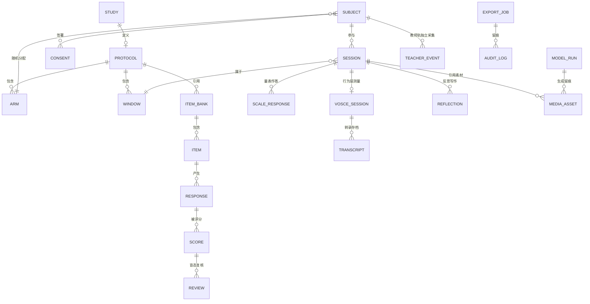
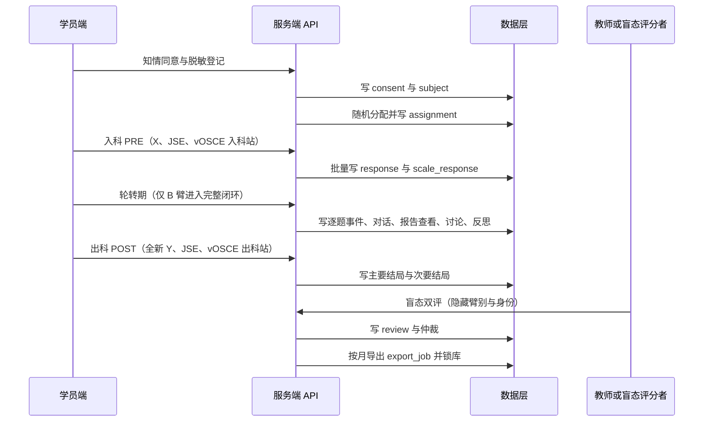

# 附录 A：研究数据底座设计

> **对应主蓝图**：`app/assets/docs/research/cstar-research-platform-blueprint.md`
> **配套附录**：`app/assets/docs/research/gap-matrix-and-roadmap.md`（附录 B）
> **版本**：v1.0 · 2026-11-11 · 状态：待评审
> **性质**：本文件是**设计规划**，描述未来实施的目标形态；本次未创建任何表、路由、驱动，也未连接任何部署集成。文中「建议 / 需 / 应 / 设计目标」均非已实现。

---

## 1. 目标、边界与技术事实

### 1.1 目标

1. 把《研究计划.md》§5.3 的数据层（结构化答题日志库、评分库、量表库、审计日志）与 §7.7 数据字典，落成可评审的域模型与字段方向。
2. 研究数据**全部落到数据库**：当前以 Turso / libSQL 为实现；为将来 EdgeOne Makers 的存储能力预留演进路径。
3. 明确 Nuxt 4 服务端约定、身份与盲态、日志与导出、合规与性能约束，供后续实施拆解任务。

### 1.2 边界

- 本附录不写最终 DDL、不写真实密钥、不写真实受试数据；字段以「方向」形式给出，实施时由 Zod schema 与迁移文件定稿。
- 不改动现有 `server/api/**`、`nuxt.config.ts`、`package.json`、`app/stores/**`；现有 8 步内容编排继续保留（主蓝图 P2）。
- 「数据库 / Blob / KV」的分工是设计目标，不代表当前已接入 EdgeOne Makers 存储。

### 1.3 已核验技术事实

| 事实 | 证据 |
| --- | --- |
| 依赖已装：`@libsql/client ^0.18.0`、`drizzle-orm ^0.45.4`、`nuxt-auth-utils ^0.6.2`、`zod ^4.6.7` | `package.json:18,25,27,32` |
| `runtimeConfig.turso.{databaseUrl,authToken}` 为服务端私有配置 | `nuxt.config.ts:70-73`；Nuxt 4 中 `useRuntimeConfig()` 仅在服务端可读私有键，客户端只见 `public` |
| 登录接口用 `createClient` from `@libsql/client/http` 直连 Turso 查 `users` 表，并 `setUserSession` | `server/api/auth/login.post.ts:1,15-24,46-51` |
| 迁移文件只有 `users`（id / name / password_hash），且 `:5` 行尾多一个逗号存在 SQL 语法瑕疵 | `server/db/migrations/001_users.sql:3-9`；后续实施需先修正 |
| `server/db/index.ts` 与 `server/utils/db.ts` 不存在；`server/utils/` 仅有 `resolveApiKey.ts` | 只读核验（附录 B 第 3 章第 8、9 条） |
| 既有规划文档已设计统一 `execute()` 驱动接口、驱动工厂、`server/db/drivers/edgeone.ts`、REST CRUD、Zod 校验、渐进迁移与回滚 | `app/assets/docs/development/database-plan.md:417-437,506-511`（**规划文字，非已实现**） |
| 既有「Record → flat nodes + parentId」树形节点模型，明确为未来新增内容类型与切换存储后端而设计 | `app/assets/docs/development/data-architecture.md:3,10,18,28`（**规划文字，非已实现**） |
| Nuxt 4 服务端：`server/api/*.get.ts` / `*.post.ts` 文件名决定方法；参数用描述性名称；`defineEventHandler`、`getRouterParam`、`readValidatedBody` / `getValidatedQuery`、`createError`；`server/utils/` 自动导入，类型可用 `#server` 别名；`server/middleware/` 做全局鉴权 | `.codebuddy/skills/nuxt/references/server.md:9-35,48-82,120-155,170-217,302-325` |
| EdgeOne Makers **没有托管数据库**（无 SQL / MongoDB / ORM）；结构化数据以 Blob 的 `setJSON` + 键前缀建模，素材亦存 Blob；KV 仅在 Edge Functions 可用 | 平台技能文档 `makers-storage/SKILL.md:11-27` 与 `references/blob.md:43-56`、`references/kv.md:1-5`（2026-11-11 核验） |
| 当前 EdgeOne 构建是 EdgeOne Pages Serverless（Nitro 产物 `.output/`，Node 24.5.0），与 Makers Functions 运行时不是同一套形态 | `edgeone.json:3`、`README.md:246-253`、`AGENTS.md` 部署章节 |

> **重要纠偏**：`database-plan.md:15` 写「未来切换 EdgeOne Makers 原生数据库」，但按平台存储技能文档，该平台**没有托管数据库**；「自带数据库」应理解为「Blob 承担结构化数据 + KV 承担小配置」。本附录据此描述能力边界，并把最终选型列为待决事项 **D2**（主蓝图第 9 章）。

---

## 2. 研究域模型

### 2.1 实体清单

| 分组 | 实体 | 含义 | 主要关联 / 对应条款 |
| --- | --- | --- | --- |
| 研究定义 | `study` | 一项研究（当前为省教改课题，未来为论文 B / C 等） | 一课题多文、共用数据底座（§21） |
| 研究定义 | `protocol` / `protocol_version` | 研究协议及冻结版本：臂别、窗口、题库、量表、量规、导出口径 | 主蓝图 P1；§7、§8 |
| 研究定义 | `arm` | 分配臂 A（不干预）/ B（完整闭环）；未来可扩展 C 组 | §7.2、§7.5 |
| 研究定义 | `window` | 入科 PRE / 轮转期训练 / 出科 POST 等测评窗口 | §7.2、§8.1(3) |
| 身份与伦理 | `subject` | 脱敏学员（哈希 ID）、轮转批次、基线协变量 | §7.7 标识域、§7.8 |
| 身份与伦理 | `consent` | 知情同意版本、签署时间、自愿参与与用途限定记录 | §7.8、R1 |
| 身份与伦理 | `assignment` | 随机分配结果、分配序列、时间戳、操作者 | §7.2 |
| 身份与伦理 | `account` / `role` | 学生 / 教师 / 盲态评分者 / 管理员；非授课教师标记 | §9、§7.8 |
| 题库与量规 | `item_bank` | 练习库（B 专属）/ 入科 X / 出科 Y 三套隔离题库 | §7.3、R3 |
| 题库与量规 | `item` | 题目：题型、维度 W1/W2/W3、rubric criterion、A/B 等值标记 | §8、手册 §2–4 |
| 题库与量规 | `rubric` / `rubric_version` | 冻结量规与权重（W1 40 / W2 30 / W3 30），锁库后不可改 | §8、§9、手册 §8 |
| 会话与作答 | `session` | 一次学习或测评会话，绑定 study / subject / window / bank | §6.1、§7.7 |
| 会话与作答 | `response` | 逐题作答：答案、开始 / 提交时间、用时、置信度 1 至 5、修改次数 | §6.1 步骤 4、§7.7 |
| 会话与作答 | `score` | AI 评分、人工双评、仲裁分、维度分、总分 0 至 100 | §9、§12 |
| 会话与作答 | `review` | 盲态评分任务：评分者、盲态字段、分歧与仲裁 | §9、分析 §8.4 |
| 量表与行为层 | `scale` / `scale_item` / `scale_response` | JSE-HPS 中文版 20 题 7 点 Likert、10 题反向计分、前后测 | §8.1(1)、§9 |
| 量表与行为层 | `vosce_script` / `vosce_session` | 平行等价剧本、考站（10 至 12 分钟，只考 W2+W3）、pre/post | §8.1(3)、分析 §8.2–8.6 |
| 量表与行为层 | `transcript` | 对话 / 语音转录文本、分段、归档引用 | 分析 §8.9 硬要求 3 |
| 内容与素材 | `case` / `story` | 病例与叙事版本、冲突点标签、审核状态 | §6.1 步骤 1–3 |
| 内容与素材 | `reflection` | 反思叙事档案（质性 / 探索性） | §8.4.1 |
| 内容与素材 | `discussion_post` | 同伴协商发言 | §6.1 步骤 5 |
| 内容与素材 | `media_asset` | 图像 / 视频 / 音频元数据、用途（训练或测评）、哈希、Blob 引用 | 主蓝图第 7 章 |
| 内容与素材 | `model_run` | 每次 AI 调用的模型 / 版本 / 温度 / 提示词版本 / 时间戳 | §5.2、§7.7 系统域 |
| 教师轨 | `teacher_event` | 工时问卷、周日志、复盘时长、scaffolding 编码、审核工作量、培训、访谈 | §7.7 教师域、§11 |
| 治理 | `audit_log` | 审核、权限变更、导出、锁库、配置变更 | §7.8、§9 |
| 治理 | `export_job` | 按月导出任务、数据字典版本、锁定状态 | §13 阶段三、§14 |

### 2.2 域模型关系

> **学生轨与教师轨并列**：`teacher_event` 不通过 `session` 关联学员流程，教师数据独立于「入科 → 出科」采集（§7.7、§11）。

### 2.3 与现有内容域的关系

| 现有机制 | 定位 | 与域模型的关系 |
| --- | --- | --- |
| `app/stores/record.ts` 的 8 步 `order` + `snapshots`（`case→story→test→act→rate→image→video→audio`） | 内容依赖与重生成提示 | **不充当实验流程**；可作为 `session` 内部的内容编排参考 |
| `app/assets/docs/development/data-architecture.md` 的 `Record → flat nodes + parentId` 树形模型 | 内容节点的通用扩展设计（规划文字） | 可用于承载 `case` / `story` / `reflection` / `media_asset` 等内容节点；研究会话与评分仍由本附录的域模型负责 |
| `app/types/` 的 10 个内容域类型 | 现有业务类型 | 未来实施时新增研究域类型文件，不改写现有内容类型 |

---

## 3. 数据表字段方向

以下均为**字段方向示意**，不是最终 DDL；实施时以迁移文件与 Zod schema 定稿。所有涉及学员的表一律只存 `subject_id_hash`，姓名、学号不出平台（§7.8）。

### 3.1 研究定义、身份与伦理

| 表 | 用途 | 关键字段方向 | 约束 / 索引 |
| --- | --- | --- | --- |
| `study` | 研究注册 | `study_id`, `code`, `title`, `principal_investigator`, `start_at`, `end_at`, `status` | 当前首个协议为省教改课题；后续研究只新增记录 |
| `protocol_version` | 冻结协议 | `protocol_id`, `study_id`, `version`, `arms`, `windows`, `bank_refs`, `scale_refs`, `rubric_refs`, `frozen_at`, `frozen_by` | 冻结后不可变；统计计划归档引用该版本（§9） |
| `arm` | 分配臂 | `arm_id`, `protocol_id`, `code`（A / B）, `description`, `intervention_flag` | A 与 B 的唯一系统差异为是否经历完整闭环 |
| `subject` | 脱敏学员 | `subject_id_hash`, `batch`, `baseline_covariates`, `enrolled_at` | 按 `batch` 建索引；不可逆哈希 |
| `consent` | 知情同意 | `consent_id`, `subject_id_hash`, `version`, `signed_at`, `voluntary`, `purpose_limitation` | 答题数据不与出科评价挂钩的书面告知留痕 |
| `assignment` | 随机化 | `assignment_id`, `subject_id_hash`, `arm_id`, `randomization_unit`, `sequence_no`, `assigned_at`, `operator_hash` | 分配序列与时间戳留痕，防选择性分配 |
| `account` / `role` | 身份与权限 | `account_id`, `role`（student / teacher / blind_rater / admin）, `is_teaching_faculty`, `scope` | 盲态评分者必须为非授课教师（§9） |

### 3.2 窗口、题库与量规

| 表 | 用途 | 关键字段方向 | 约束 / 索引 |
| --- | --- | --- | --- |
| `session` | 学习或测评会话 | `session_id`, `study_id`, `subject_id_hash`, `window_id`, `bank_tag`, `started_at`, `ended_at`, `completion_flag` | 索引：`subject_id_hash + window_id`、`batch + occurred_at` |
| `item_bank` | 三套隔离题库 | `bank_id`, `study_id`, `bank_tag`（practice / X / Y）, `is_excluded_from_assessment` | 练习库不得进入任何测评（§7.3） |
| `item` | 题目 | `item_id`, `bank_id`, `type`（choice / short_answer / dialogue）, `dimension`（W1 / W2 / W3）, `criterion_refs`, `equivalent_pair_id`, `content_hash` | `equivalent_pair_id` 支撑 A/B 格式等价校验 |
| `rubric_version` | 冻结量规 | `rubric_id`, `version`, `weights`（W1 40 / W2 30 / W3 30）, `criteria`, `frozen_at`, `approved_by` | 2 名专家审定后冻结；锁库前定稿（§8、§9） |

### 3.3 作答、评分与盲态复核

| 表 | 用途 | 关键字段方向 | 约束 / 索引 |
| --- | --- | --- | --- |
| `response` | 逐题作答 | `response_id`, `session_id`, `item_id`, `bank_tag`, `dimension`, `answer`, `started_at`, `submitted_at`, `duration_ms`, `confidence`（1 至 5）, `revision_count`, `event_id` | `event_id` 幂等去重；批量写入；主要结局数据源 |
| `score` | 评分结果 | `score_id`, `response_id`, `channel`（auto / llm_assist / human / arbitration）, `criterion_scores`, `dimension_scores`, `total_0_100`, `rubric_version` | 同一作答可有多通道评分，便于人机一致性分析 |
| `review` | 盲态双评 | `review_id`, `score_id`, `rater_hash`, `blinded_fields`, `submitted_at`, `agreement_flag`, `arbitrated_by` | 隐藏臂别、身份、题库标签、pre/post 时点；分歧触发第三人仲裁 |

### 3.4 量表与行为层测量

| 表 | 用途 | 关键字段方向 | 约束 / 索引 |
| --- | --- | --- | --- |
| `scale` / `scale_item` | 量表定义 | `scale_id`, `name`（JSE-HPS 中文版）, `version`, `item_no`, `reverse_scored`, `factor` | 20 题、7 点 Likert、10 题反向计分；注明中文版出处 |
| `scale_response` | 量表作答 | `scale_response_id`, `subject_id_hash`, `window_id`, `item_no`, `raw_value`, `scored_value`, `submitted_at` | 前后测配对；预试验检验 α ≥0.80 |
| `vosce_script` | 平行等价剧本 | `script_id`, `form`（parallel A / B）, `persona_config`, `frozen_at`, `media_ref` | 与训练引擎独立；交叉平衡防练习效应 |
| `vosce_session` | 考站 | `vosce_id`, `subject_id_hash`, `window_id`, `script_id`, `duration_min`, `rubric_version`, `transcript_ref` | 只考 W2+W3；评分归一化 0 至 100 |
| `vosce_score` | 盲态评分 | `vosce_score_id`, `vosce_id`, `rater_hash`, `item_scores`（6 项或 OS-12）, `narrative_feedback` | AI 不自动评分；每项附 1 至 2 句叙事反馈 |
| `transcript` | 转录存档 | `transcript_id`, `vosce_id`, `text`, `segments`, `model_run_id`, `media_ref`, `content_hash` | 供复评与答辩质证；原始音频 / 录像存 Blob |

### 3.5 内容、素材与版本留痕

| 表 | 用途 | 关键字段方向 | 约束 / 索引 |
| --- | --- | --- | --- |
| `case` / `story` | 病例与叙事版本 | `content_id`, `study_id`, `type`, `conflict_tags`, `version`, `review_status`, `reviewed_by`, `content_hash` | 审核冻结后方可投放；去标识化 |
| `reflection` / `discussion_post` | 反思与同伴协商 | `id`, `session_id`, `author_hash`, `text`, `submitted_at`, `coding` | 按批次隔离讨论区；反思档案为探索性质性数据 |
| `media_asset` | 多模态素材元数据 | `asset_id`, `type`（image / video / audio）, `usage`（training / assessment）, `blob_ref`, `content_hash`, `rubric_or_script_ref`, `frozen_at` | **大文件不入库**；训练与测评素材不得共用 |
| `model_run` | AI 调用留痕 | `run_id`, `model_id`, `model_version`, `temperature`, `prompt_template_version`, `called_at`, `purpose`, `output_hash` | 支撑可复现；§5.2 全量日志留痕 |

### 3.6 教师轨、审计与导出

| 表 | 用途 | 关键字段方向 | 约束 / 索引 |
| --- | --- | --- | --- |
| `teacher_event` | 教师平行采集 | `event_id`, `teacher_hash`, `type`（worktime_survey / weekly_log / debrief / scaffolding_code / review_workload / training / interview / platform_trace）, `duration_min`, `coding`, `occurred_at` | 独立于学员流程；scaffolding 编码：追问 / 支架 / 元认知提示 / 情感支持 / 纠偏 |
| `audit_log` | 审计 | `log_id`, `actor_hash`, `action`, `target`, `before_hash`, `after_hash`, `occurred_at`, `reason` | 审核、权限变更、导出、锁库、配置变更全量留痕 |
| `export_job` | 按月导出 | `export_id`, `study_id`, `period`, `data_dictionary_version`, `row_count`, `checksum`, `exported_by`, `locked_flag` | 锁库后只读；导出内容与数据字典版本绑定 |

---

## 4. 三类日志

| 类别 | 目的 | 粒度与示例 | 是否可作为研究证据 | 留存 |
| --- | --- | --- | --- | --- |
| 业务日志 | 排障、性能观测 | 接口耗时、生成失败、轮询状态、前端错误 | 否 | 短期运维留存 |
| 研究事件日志 | 「答题即数据」与机制分析 | `item.started`、`item.submitted`、`confidence.reported`、`story.read`、`dialogue.turn`、`report.viewed`、`reflection.submitted`、`discussion.posted` | **是**，主要结局与过程性证据来源 | 与课题数据同期限（结题后 5 年） |
| 审计日志 | 合规与可追溯 | `content.approved`、`rubric.frozen`、`assignment.created`、`score.reviewed`、`export.generated`、`data.locked` | 是（用于质证，不进入结局变量） | 与课题数据同期限 |

**事件设计要求（未来实施）**：

- 每个事件带 `event_id` 幂等键、`occurred_at`、脱敏主体、协议版本、模型 / 提示词版本引用；写入失败须重试与补偿，不得丢失主要结局数据。
- 逐题事件**批量写入**（按会话或时间窗聚合），避免每答一题一次请求；前端可先本地缓冲，但研究证据以服务端入库为准，浏览器本地存储只作断网补偿。
- 观测指标建议：事件写入失败率与积压、导出任务耗时、双评分歧率、ICC 计算输入完整性、审核队列积压；这些属于**可观测性设计**，本次不实施。

---

## 5. 关键时序

### 5.1 入组、随机化与测评窗口

### 5.2 分环节要点

| 环节 | 要点 |
| --- | --- |
| 随机化 | 按轮转批次或个体分配；序列、单位、时间戳留痕；两组入科基线 X 均衡由 ANCOVA 调整（§7.2、§7.5） |
| 三库隔离 | 会话绑定 `bank_tag`；出科 Y 与练习库、X 不重叠；批次错开防透题（§7.3、R3） |
| 答题即数据 | 逐题事件与置信度、用时同步入库；无效作答（时长过短、全同作答）按规则标记而非静默丢弃（§9、R10） |
| 盲态双评 | 系统隐藏臂别 / 身份 / 题库标签 / 时点；2 名非授课教师双评，分歧第三人仲裁；同时计算人—人 ICC 与 AI—人一致性（§9、分析 §8.4） |
| vOSCE | 独立人格与平行等价剧本；刺激标准化；全程转录 / 录像归档；盲态教师按 OS-12 / Calgary 量规评分；AI 只生成患者不评分（§8.1(3)、分析 §8.9） |
| 导出与锁定 | 按月导出并附数据字典版本与校验和；统计计划锁库前归档；锁库后数据只读，变更须走审计（§9、§13、§14） |

---

## 6. API 表面与 Nuxt 4 服务端约定

### 6.1 约定

| 项目 | 约定 |
| --- | --- |
| 目录与命名 | 研究接口置于 `server/api/research/` 下；`*.get.ts` / `*.post.ts` 决定方法；动态参数使用描述性名称（如 `[studyId].get.ts`），不用泛化的 `[id].get.ts` |
| 处理器 | `defineEventHandler`、`getRouterParam`、`getQuery`、`readBody` / `readValidatedBody`、`getValidatedQuery`、`createError`；Nuxt 4 使用 h3 v1 / nitropack v2 约定 |
| 校验 | 建议用项目已装的 `zod` 定义请求与响应 schema，经 `readValidatedBody` / `getValidatedQuery` 校验；量规与权重等关键结构以 Zod 锁定 |
| 复用 | 数据访问封装为 `server/utils/` 下自动导入的 Repository；仅类型可通过 `#server` 别名被客户端引用 |
| 鉴权 | 沿用 `nuxt-auth-utils` 的 `setUserSession`（`server/api/auth/login.post.ts:46-51`）；在 `server/middleware/` 做角色与盲态校验；`app/stores/user.ts` 空壳需在未来实施中重建 |
| 配置 | Turso 凭据等密钥只放 `runtimeConfig` 私有键，服务端 `useRuntimeConfig()` 读取；客户端只暴露 `public`（`nuxt.config.ts:60-74`） |
| 错误与可观测 | 统一错误响应、参数化查询防注入、失败重试与补偿；缓存只用于非研究数据（如文档 / 静态字典），研究事件与评分不缓存 |

### 6.2 路由组（设计目标）

| 路由组 | 方法 | 权限 | 关键约束 |
| --- | --- | --- | --- |
| `/api/research/studies`、`/protocols` | GET / POST | 管理员、教师 | 协议冻结后不可修改，只新增版本 |
| `/api/research/subjects`、`/assignments` | GET / POST | 管理员、非授课招募者 | 脱敏 ID；分配序列留痕 |
| `/api/research/sessions` | GET / POST | 学生（本人）、教师（聚合） | 绑定窗口与题库标签 |
| `/api/research/items`、`/banks` | GET / POST | 教师 | 三库隔离、A/B 格式等价校验 |
| `/api/research/responses` | POST（批量） | 学生（本人） | 幂等 `event_id`；置信度与用时 |
| `/api/research/scores`、`/reviews` | GET / POST | 盲态评分者、管理员 | 盲态字段过滤；分歧仲裁 |
| `/api/research/scales`、`/vosce` | GET / POST | 学生、盲态评分者 | 平行剧本；转录归档；AI 不评分 |
| `/api/research/media` | GET / POST | 教师、学生（只读冻结素材） | 素材元数据与 Blob 引用；训练 / 测评用途隔离 |
| `/api/research/teacher-events` | GET / POST | 教师 | 教师轨独立采集 |
| `/api/research/exports`、`/audit` | GET / POST | 管理员 | 按月导出、校验和、锁库只读 |

> 以上路由**均不存在于当前仓库**，属于未来实施建议；现有 `server/api/` 15 个路由中无任何研究接口（附录 B 第 3 章第 8 条）。

---

## 7. 随机化、盲态与一致性门控

| 主题 | 数据口径与门控 |
| --- | --- |
| 随机化 | 记录分配单位（批次 / 个体）、序列、时间戳、操作者哈希；A 臂不接触 CSTAR 训练，B 臂完成 10 至 20 套完整闭环（§7.2） |
| 盲态 | 评分视图隐藏臂别、学员身份、题库标签、pre/post 时点；评估者受训并校准；使用非授课教师避免沾光效应（§9、分析 §8.4） |
| 冻结 | 三维度权重与 rubric 由 2 名专家审定后冻结；统计计划数据锁定前归档；变更须新增版本并写审计（§8、§9） |
| 一致性 | 同时报告人—人 ICC 与 AI—人 Pearson r / ICC / 加权 κ + Bland-Altman；**ICC ≥0.75** 方可进入分析；未达标降级为「AI 辅助、人工主导」（§9、§10.4） |
| 量表信度 | 预试验检验 JSE 中文版 **Cronbach's α ≥0.80**；注明出处与 10 道反向题（§8.1(1)、§9） |
| 数据质量 | 无效作答剔除规则；缺失率小于 5% 多重插补，超过则敏感性分析；ITT 与 PP 双分析集（§9、R10） |
| 结局边界 | 单一主要结局（Y 总分 0 至 100），ANCOVA 以 X 为协变量；vOSCE 与主结局同构分析；结论限定为「CSTAR 程序效应」（§7.5、§8） |

> 本节描述的是**数据口径与门控条件**，不是已实现的统计代码；实施时统计计划须在锁库前单独归档。

---

## 8. 存储分工与演进

### 8.1 当前：Turso / libSQL

- 结构化研究数据（第 3 章各表）入 Turso；凭据走 `runtimeConfig.turso`（`nuxt.config.ts:70-73`）。
- 建议沿用 `app/assets/docs/development/database-plan.md:417-437` 的**统一 `execute()` 驱动接口 + 驱动工厂 + Repository** 设计，新增 `server/db/index.ts`、`server/db/drivers/turso.ts`、`server/utils/db.ts`、迁移文件与 Zod 校验；其「localStorage 渐进迁移、备份与回滚」思路同样适用。
- 实施前置修正：`server/db/migrations/001_users.sql:5` 行尾多余逗号的 SQL 语法瑕疵；并明确 `users` 表现有字段不足以支撑角色与盲态，需要扩展或新建研究账号表。
- 现有浏览器 localStorage 只保留为非研究内容的用户偏好与断网补偿，**不再作为研究证据来源**。

### 8.2 演进目标：EdgeOne Makers 能力边界（2026-11 核验）

| 能力 | 事实 | 对设计的影响 |
| --- | --- | --- |
| 托管数据库 | **没有**（无 SQL / MongoDB / ORM）；Blob 即数据库 | 不能假设存在一个「EdgeOne Makers 原生 SQL 数据库」可直接替换 Turso；结构化数据需改为 Blob 的 `setJSON` + 键前缀建模，或继续外接数据库 |
| Blob（Cloud Functions） | SDK `@edgeone/pages-blob`，版本要求 ≥0.0.14；`getStore({ name, consistency: 'strong' })`；`set` / `setJSON` / `get(key, { type: 'json' })` / `list({ prefix })` | 一记录一 JSON 文件适合增长型、并发写入的数据；单文档仅适合小而低并发的配置；**必须强一致**，否则出现「刚写读不到」 |
| KV（仅 Edge Functions） | 需控制台启用并绑定命名空间；以全局变量访问；最终一致 60 秒；单值 ≤25 MB、键 ≤512 字节；Node Functions 不支持 | **不得**用于随机化分配、评分、锁库等强一致研究状态；只适合小配置、缓存、非关键会话标记 |
| 运行时差异 | 当前 `pnpm edgeone` 是 EdgeOne Pages Serverless（Nitro `.output/`，Node 24.5.0）；Makers 的 Blob / KV 属于 Makers Functions 运行时 | 不能假定现有 Nitro `server/api/**` 可直接调用 KV 全局变量；需要适配层或独立的 Makers Functions，驱动抽象因此更重要 |

### 8.3 三种演进路径（待决，不预设结论）

| 路径 | 形态 | 优点 | 代价 / 风险 | 适用判断 |
| --- | --- | --- | --- | --- |
| A · 继续外接 Turso | Nitro Serverless + Turso（或院内自建 libSQL） | 与现有 `nuxt.config.ts` / 登录接口一致，SQL 关系查询与统计友好 | 仍依赖外部数据库；需解决数据驻留与院内本地化要求 | 正式采集期、需要复杂查询与 ANCOVA 数据准备时的稳妥选择 |
| B · Blob 为主 + KV 辅助 | Makers Cloud Functions 用 Blob 存结构化 JSON 与素材，KV 存小配置 | 完全使用平台自带存储，部署一体 | 无 SQL 查询与事务；需自建索引 / 导出 / 一致性策略；KV 最终一致 | 面向未来轻量研究或演示环境，需重新设计查询层 |
| C · 院内本地化 | 院内服务器 / 本地 SQLite 或 libSQL + 本地文件存储 | 最贴合《研究计划.md》§5.2、§7.8 敏感数据合规与固定模型版本可复现 | 需运维、备份、加密与访问控制；与 EdgeOne 部署形态分离 | 正式采集期若伦理 / 数据合规要求数据不出院，应优先 |

> **待决 D1**（部署形态与数据驻留）与 **D2**（EdgeOne Makers 无托管数据库下的最终选型）见主蓝图第 9 章。本附录只给出事实与选项，不替课题方决定。

### 8.4 数据分工与迁移

| 数据 | 存放位置（设计目标） | 说明 |
| --- | --- | --- |
| 结构化研究数据 | 数据库（当前 Turso） | 第 3 章各表；路径 B 下改为 Blob 键前缀 JSON |
| 图像 / 视频 / 音频 / 转录 / 录像 | Blob（对象存储） | 库内只存 `blob_ref` 与 `content_hash`；内容寻址、冻结版本不可覆盖 |
| 会话标记、非关键配置、缓存 | KV（仅 Edge Functions 可用时） | 不承载随机化、评分、锁库等强一致状态 |
| 导出包与数据字典 | 对象存储 + 数据库任务记录 | 按月分批导出，附版本号与校验和 |

迁移顺序建议：导出与校验 → 建立目标驱动 → 双写或灰度切换 → 一致性核对 → 切换读路径 → 保留回滚点与备份（沿用 `database-plan.md` 的迁移 / 回滚章节）。

---

## 9. 合规取舍与风险

| 编号 | 主题 | 要求 / 风险 | 建议控制 |
| --- | --- | --- | --- |
| G-01 | 院内本地化 vs 云端 | 《研究计划.md》§5.2、§7.8 要求院内本地化部署、脱敏、RBAC、传输与静态加密；Turso / EdgeOne 属云端 | 列为待决 D1；正式采集前由伦理与数据合规方确认数据驻留边界 |
| G-02 | 脱敏与用途限定 | 姓名 / 学号不出平台，ID 哈希化；虚拟患者为合成数据；答题数据不与出科成绩 / 个人评价挂钩 | 表设计只存哈希；知情同意版本与用途限定字段；非授课教师招募 |
| G-03 | 权限与盲态 | 角色提升或盲态字段泄露会破坏内部效度 | RBAC + 服务端强制字段过滤；盲态视图独立；审计日志记录每次变更 |
| G-04 | 一致性与并发 | Blob 单文档读改写覆盖；KV 最终一致 60 秒 | 一记录一文件、强一致 `getStore`；强一致状态不进 KV；并发写入用幂等键 |
| G-05 | 可复现 | 模型 / 提示词版本漂移会导致刺激不一致 | `model_run` 留痕；冻结素材与量规；采集期禁止重新生成冻结版本 |
| G-06 | 留存与导出 | 结题后保存 5 年；按月导出；锁库后只读 | `export_job` + 校验和 + 审计；导出包脱敏并附数据字典版本 |
| G-07 | 现有迁移瑕疵 | `001_users.sql:5` 行尾多余逗号 | 实施前先修正迁移脚本并补测试 |
| G-08 | 人工智能评分边界 | AI 自动评分被误用作确证证据 | 评分通道标记 `auto` / `llm_assist` / `human` / `arbitration`；确证分析只采用人工共识或仲裁分 |

---

## 10. 性能、可靠性与可观测性设计提示（未来实施）

| 主题 | 建议 |
| --- | --- |
| 热路径 | 逐题事件批量写入；一次会话聚合提交；避免按题逐条查询评分造成 N+1 |
| 索引 | 按 `subject_id_hash`、`batch`、`bank_tag`、`window_id`、`occurred_at` 建复合索引；导出按时间与批次分批 |
| 大对象 | 素材、转录、录像只存 Blob 引用与哈希，不入库；内容寻址便于去重与完整性校验 |
| 缓存 | 仅缓存非研究数据（文档、静态字典）；研究事件、评分、随机化结果不缓存，避免脏读 |
| 错误处理 | 事件写入失败重试与补偿队列；幂等 `event_id` 防重复；导出失败可重跑且结果一致 |
| 可观测性 | 监控事件写入失败率 / 积压、导出耗时、双评分歧率、审核队列、ICC 输入完整性；业务日志与研究事件日志分离 |
| 代码质量 | 研究域类型集中定义；Zod schema 同时用于 API 校验与类型推导；Repository 统一封装，避免各路由直接拼 SQL |

> 以上均为实施阶段的设计提示，本次未实现、未压测、未连接任何监控。

---

## 11. 引用与待决事项

| 引用 | 用途 |
| --- | --- |
| 主蓝图第 2、4、6、7、8、9 章 | 研究基线、总体定位、模块规格、红线、扩展机制与待决事项 |
| 附录 B 第 2 章 D-01 至 D-15、Q-01 至 Q-10 | 本附录对应的差距项与验收口径 |
| `app/assets/docs/development/database-plan.md` | 驱动抽象、REST CRUD、Zod、渐进迁移与回滚（规划文字） |
| `app/assets/docs/development/data-architecture.md` | 内容节点树形扩展（规划文字） |
| `.codebuddy/skills/nuxt/references/server.md`、`nuxt-config.md` | Nuxt 4 服务端与运行时配置约定 |
| EdgeOne Makers `makers-storage/SKILL.md` 及 `references/blob.md`、`references/kv.md` | Blob / KV 能力边界（2026-11-11 核验） |
| `AGENTS.md` | 简体中文、Nuxt UI v4、Pinia 版本控制、ai SDK 优先、EdgeOne 部署规范 |

**待决事项**：D1（正式采集期部署形态与数据驻留）、D2（EdgeOne Makers 无托管数据库下的最终存储选型）、D3（统计计划与量规冻结责任人及时间）、D4（多模态转录服务的 provider 选型）——统一在主蓝图第 9 章登记。
